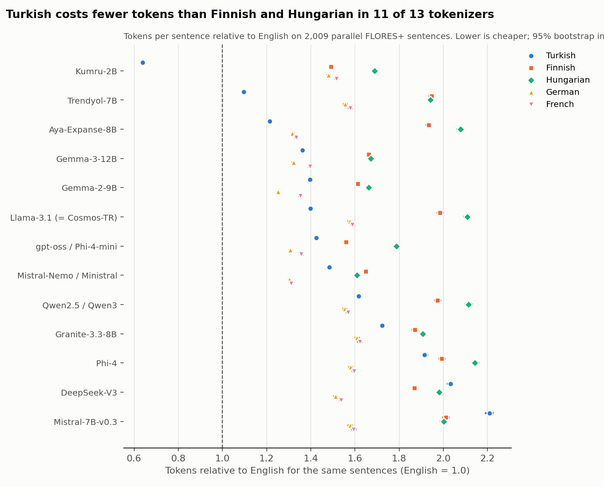
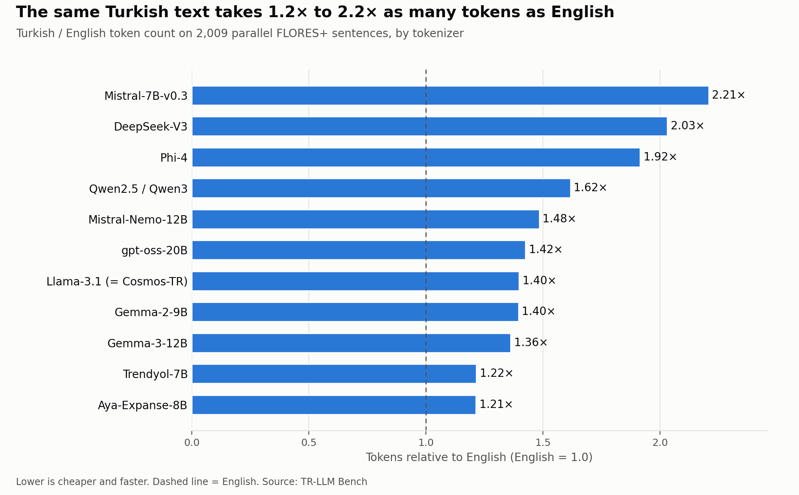
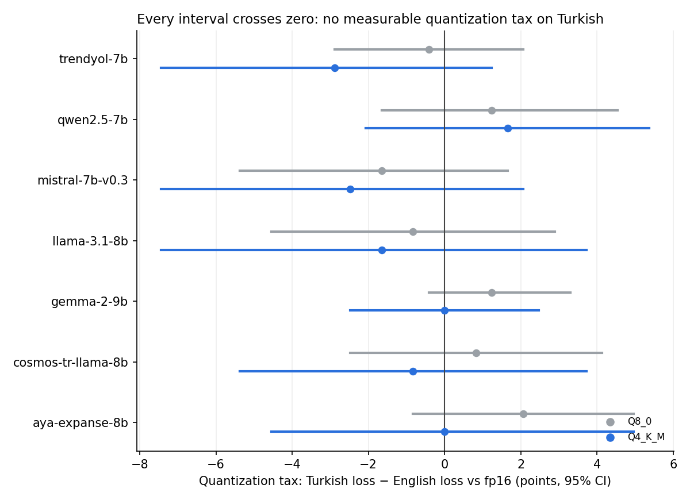
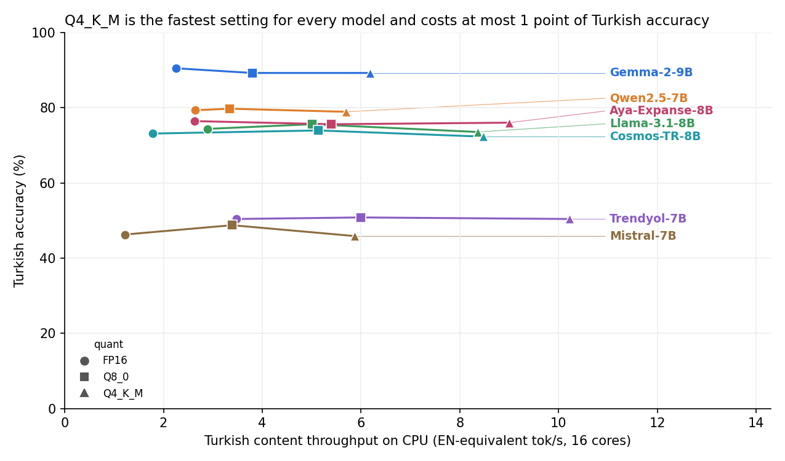

# TR-LLM Bench

How much does Turkish cost to serve on open LLMs, and how much quality does
quantization take away from Turkish compared with English?

**[Leaderboard](https://huggingface.co/spaces/HaticeB/tr-llm-bench)** · **[Eval set](https://huggingface.co/datasets/HaticeB/tr-llm-bench-eval)**

Everything here is measured on parallel TR/EN data with deterministic scoring
(seed 2026, no LLM judge), so the Turkish and English numbers are directly comparable.

## 1. Tokenizer tax

The same FLORES+ sentences take a different number of tokens per language.
**Tax = total Turkish tokens / total English tokens.** Fertility (tokens per word)
is not used because word lengths differ across languages.

| Tokenizer (models sharing it) | TR | FI | HU | DE | FR |
|---|---|---|---|---|---|
| Kumru-2B (Turkish-focused) | 0.64 | 1.49 | 1.69 | 1.48 | 1.52 |
| Trendyol-7B | 1.10–1.22 ¹ | 1.95 | 1.94 | 1.56 | 1.58 |
| Aya-Expanse-8B | 1.21 | 1.93 | 2.08 | 1.32 | 1.33 |
| Gemma-3-12B | 1.36 | 1.66 | 1.67 | 1.32 | 1.40 |
| Gemma-2-9B | 1.40 | 1.61 | 1.66 | 1.25 | 1.35 |
| Llama-3.1-8B / Cosmos-TR-Llama-8B | 1.40 | 1.98 | 2.11 | 1.58 | 1.59 |
| gpt-oss-20b / Phi-4-mini | 1.42 | 1.56 | 1.79 | 1.31 | 1.36 |
| Mistral-Nemo-12B / Ministral-8B | 1.48 | 1.65 | 1.61 | 1.30 | 1.31 |
| Qwen2.5-7B / Qwen3-8B | 1.62 | 1.97 | 2.11 | 1.55 | 1.57 |
| Granite-3.3-8B | 1.72 | 1.87 | 1.91 | 1.61 | 1.62 |
| Phi-4 | 1.92 | 1.99 | 2.14 | 1.58 | 1.59 |
| DeepSeek-V3 | 2.03 | 1.87 | 1.98 | 1.51 | 1.54 |
| Mistral-7B-v0.3 | 2.21 | 2.01 | 2.00 | 1.58 | 1.59 |

Tokens relative to English (English = 1.0) on the same 2,009 sentences. 95% bootstrap intervals
(resampling sentences, paired across languages) are in `results/tokenizer_langs.csv`;
per-sentence token counts (numbers only, no text) in `results/tokenizer_counts.csv.gz`.

A 1.62 tax means the same Turkish content costs 62% more tokens: more latency,
less effective context and lower content throughput. Trendyol's Turkish vocabulary
extension (32,768 → 44,312 tokens) cuts the tax to roughly Aya's level.

**The cost is not specific to Turkish.** Turkish needs fewer tokens than the other two
agglutinative languages, Finnish and Hungarian, in 11 of 13 distinct tokenizers (no interval overlaps);
the exceptions are Mistral-7B-v0.3 and DeepSeek-V3. Against German and French the picture is mixed.
This points to the tokenizer's training data rather than morphology alone: a Turkish-focused
tokenizer (Kumru) makes Turkish *cheaper* than English.

¹ *Same tokenizer files (repo unchanged since June 2024), different libraries:* the fast tokenizer in
transformers 4.57.3 gives 1.10, the SentencePiece (slow) tokenizer 1.12, and the earlier run with an
older transformers gave 1.22. Every tokenizer row now records the repo commit, tokenizer class and
library versions. All other tokenizers reproduced exactly.





## 2. Serving performance (vLLM, V100)

Load tests use fixed output length (`min_tokens` + `ignore_eos`) and streaming TTFT.
Raw tok/s is reported together with **content throughput = tok/s ÷ tax**,
because Turkish tokens carry less content than English ones.

Qwen2.5-7B-Instruct, vLLM, one V100 32 GB, 256 output tokens per request, median of 3 repeats.
*Provenance:* measured on 16 Nov 2026 with an earlier version of `configs/phase3.yaml`
(GPU memory utilization 0.80, CUDA graphs on). That setting used more memory than the shared
server's budget allows, so the config was retired and now holds the in-budget settings;
these numbers cannot be reproduced from the current config and are kept as a historical result.
**Content tok/s = TR tok/s ÷ 1.62** (Qwen's tokenizer tax), i.e. how much English-equivalent content Turkish users get.

| Quant | Concurrency | EN tok/s | TR tok/s | TR content tok/s | TTFT p50 EN / TR (ms) |
|---|---|---|---|---|---|
| fp16 | 1 | 15.5 | 15.6 | 9.6 | 84 / 84 |
| fp16 | 4 | 61.0 | 60.6 | 37.4 | 217 / 196 |
| fp16 | 16 | 185.5 | 185.5 | 114.5 | 412 / 404 |
| fp16 | 32 | 273.8 | 265.0 | 163.6 | 540 / 602 |
| AWQ-int4 | 1 | 32.6 | 31.6 | 19.5 | 57 / 60 |
| AWQ-int4 | 4 | 124.6 | 122.7 | 75.7 | 117 / 125 |
| AWQ-int4 | 16 | 352.4 | 315.5 | 194.7 | 261 / 252 |
| AWQ-int4 | 32 | 449.9 | 431.0 | 266.0 | 529 / 554 |

- **The engine is language-neutral, the tokenizer is not.** Raw tok/s is almost identical
  for Turkish and English, yet Turkish users get ~38% less content per second.
- **AWQ-int4 roughly doubles throughput** over fp16 on V100 at every concurrency level
  (single-stream decoding is memory-bound, so 4× smaller weights pay off).
- Qwen2.5-14B AWQ-int4 (Turkish only, partial run): 17.7 tok/s at c=1, 203 tok/s at c=32.

Finding: GPTQ-int8 does not run on V100 (SM70) for models with attention bias
(e.g. Qwen), because the Marlin kernel does not support bias.

## 3. Quantization tax on Turkish quality (llama.cpp, CPU)

550 items: parallel TR/EN reading (Belebele), knowledge (Global-MMLU,
culturally agnostic subset), math (GSM8K / GSM8K-TR), instruction following,
JSON extraction, plus a Turkish-only morphology set.

**Quantization tax = (accuracy loss in TR) − (accuracy loss in EN)** relative to fp16,
with bootstrap 95% confidence intervals.

Seven instruct models, GGUF built from the original weights (Qwen: official GGUF),
llama.cpp `b12470`, CPU, greedy decoding. fp16 accuracy (%, TR / EN), with the 8
mistranslated items removed (see below):

| Model | Reading | Knowledge | Math | Instruction | JSON | Morphology (TR) |
|---|---|---|---|---|---|---|
| Gemma-2-9B | 87 / 95 | 63 / 66 | 97 / 97 | 98 / 85 | 100 / 100 | 88 |
| Qwen2.5-7B | 85 / 95 | 45 / 68 | 79 / 95 | 78 / 75 | 100 / 100 | 64 |
| Aya-Expanse-8B | 84 / 96 | 53 / 63 | 69 / 85 | 70 / 83 | 100 / 100 | 90 |
| Cosmos-TR-Llama-8B | 75 / 96 | 50 / 55 | 69 / 77 | 67 / 77 | 100 / 100 | 88 |
| Llama-3.1-8B | 67 / 91 | 58 / 61 | 79 / 90 | 67 / 97 | 100 / 100 | 66 |
| Trendyol-7B v1.8 | 82 / 78 | 50 / 58 | 36 / 36 | 32 / 18 | 50 / 50 | 86 |
| Mistral-7B-v0.3 | 35 / 87 | 42 / 53 | 23 / 59 | 32 / 60 | 98 / 100 | 64 |



Quantization tax over 242 paired items (percentage points, positive = Turkish loses more,
95% bootstrap CI):

| Model | Q8_0 | Q4_K_M |
|---|---|---|
| Gemma-2-9B | +1.2 [−0.4, +3.3] | −0.0 [−2.5, +2.5] |
| Qwen2.5-7B | +1.2 [−1.7, +4.5] | +1.7 [−2.1, +5.4] |
| Aya-Expanse-8B | +2.1 [−0.8, +5.0] | +0.0 [−4.5, +5.0] |
| Cosmos-TR-Llama-8B | +0.8 [−2.5, +4.1] | −0.8 [−5.4, +3.7] |
| Llama-3.1-8B | −0.8 [−4.5, +2.9] | −1.7 [−7.4, +3.7] |
| Trendyol-7B v1.8 | −0.4 [−2.9, +2.1] | −2.9 [−7.4, +1.2] |
| Mistral-7B-v0.3 | −1.7 [−5.4, +1.7] | −2.5 [−7.4, +2.1] |

- **No measurable quantization tax in any of the seven models.** All 14 intervals include
  zero: down to Q4_K_M, Turkish does not degrade more than English.
- **The language gap is set by the base model, and it varies a lot.** Gemma-2-9B is at
  parity in math and close in knowledge; Qwen2.5-7B trails by 23 points in knowledge;
  Llama-3.1-8B trails by 24 in reading and by 30 in Turkish instruction following;
  Mistral-7B, the model with the worst tokenizer tax (2.21×), is weakest in Turkish overall.
- **Multilingual and Turkish-tuned models lead on morphology:** Aya 90, Gemma 88, Cosmos 88,
  Trendyol 86, against 64–66 for Qwen, Llama and Mistral.
- **Turkish fine-tuning helps Turkish, but can leak into structured output.** Trendyol-7B v1.8
  is the only model better in Turkish than in English at reading (82 vs 78), but half its
  JSON is invalid: it writes Turkish decimal commas (`"birim_fiyat": 3,75`) and Turkish keys
  even when the prompt is English. Cosmos (Llama-3 fine-tuned on Turkish) gains on reading
  and morphology over Llama-3.1-8B without that side effect.
- **Practical traps found along the way:**
  - Trendyol-7B v1.8 (Mistral-based) ships no chat template. llama.cpp silently fell back
    to ChatML and the first run was nonsense; the numbers above come from a re-run with its
    `[INST]` format (`configs/chat_templates/mistral_inst.jinja`). Check the template of
    every converted model; `scripts/queue_models.sh` now refuses to measure a model without one.
  - Aya printed its end-of-turn token (`<|END_OF_TURN_TOKEN|>`) as text, and answered
    multiple choice as a bare letter followed by an explanation. Responses were cut at the
    turn token (identical to a correct stop under greedy decoding; `trbench.eval.rescore`)
    and the scorer was fixed to read a bare letter followed by a newline. All models were
    re-scored with the same rules; only Aya and 4 Gemma items changed.

### How much of the gap is the benchmark's fault?

All 38 items that fp16 got wrong in Turkish but right in English were reviewed by hand:
**30 are genuine model errors, 8 are translation errors** that change the meaning of
the Turkish item, and 0 are scoring errors. Examples of meaning-changing errors:

- Belebele-TR: a "not true" option was negated in translation, so it became true;
  "rotation" became "orbit" in the passage but "rotation" in the options;
  "airline" became "airport" in the options.
- Global-MMLU-TR: "EXCEPT" was dropped, reversing the question; "H2O(s)" (solid)
  became "H2O(lar)" (a Turkish plural suffix).
- GSM8K-TR: "200 taps per minute with each foot" became ambiguous ("with both feet").

Turkish–English gap at fp16 after removing those 8 items:

| Category | Raw gap | Corrected gap |
|---|---|---|
| Reading | 16.7 pts | 9.0 pts |
| Knowledge | 27.5 pts | 23.7 pts |
| Math | 17.5 pts | 15.4 pts |

**About half of the reading gap comes from Belebele-TR translation quality, not from the
model.** The knowledge and math gaps are mostly real. Several other items contain term
errors that do not change the answer (e.g. "24 hours" → "24 seconds",
"discount rate" → "indirim oranı" instead of "reeskont oranı").

## 4. Quality vs. speed on CPU

`llama-bench` (llama.cpp `b12470`, 16 cores, 128 generated tokens, 3 repeats) on every GGUF,
with **Turkish content throughput = tok/s ÷ tokenizer tax** and Turkish accuracy over the
paired categories (mistranslated items removed).



Q4_K_M, the fastest setting of each model:

| Model (Q4_K_M) | CPU tok/s | TR content tok/s | TR accuracy % |
|---|---|---|---|
| **Gemma-2-9B** | 8.7 | 6.2 | 89 |
| Qwen2.5-7B | 9.2 | 5.7 | 79 |
| **Aya-Expanse-8B** | 10.9 | 9.0 | 76 |
| Llama-3.1-8B | 11.7 | 8.4 | 74 |
| Cosmos-TR-Llama-8B | 11.9 | 8.5 | 72 |
| Trendyol-7B v1.8 | 12.5 | 10.2 | 50 |
| Mistral-7B-v0.3 | 13.0 | 5.9 | 46 |

- **Q4_K_M costs at most 1 point of Turkish accuracy in every model** and is its fastest
  setting.
- **Gemma-2-9B Q4_K_M is the most accurate; Aya-Expanse-8B Q4_K_M is the next point on the quality–speed frontier**
  (9.0 Turkish content tok/s at 76%), helped by the lowest tokenizer tax (1.21×).
- Raw speed is not content speed: Mistral-7B is the fastest model in tokens (13.0 tok/s) but
  its 2.21× tax leaves it among the slowest in Turkish content (5.9).
- fp16 CPU speed depends on memory placement: Cosmos and Mistral fp16 measured 2.5 and
  2.7 tok/s, twice repeated, while their same-architecture twins (Llama, Trendyol) ran
  at 4.1–4.2 and all four match within 0.4 tok/s at Q8_0 and Q4_K_M. Compare models at
  Q8_0 or Q4_K_M.

### Input length

Q4_K_M, 16 cores. Prompt reading at 256 / 1,024 / 4,096 tokens, and generation with an
empty vs a 4,096-token context:

| Model | Read 256 | Read 1k | Read 4k (tok/s) | Generate, empty | Generate, 4k context |
|---|---|---|---|---|---|
| Qwen2.5-7B | 65.7 | 64.7 | 58.0 | 11.4 | 8.3 |
| Gemma-2-9B | 50.6 | 48.5 | 41.9 | 8.8 | 5.6 |
| Llama-3.1-8B | 62.3 | 60.2 | 52.6 | 11.9 | 8.3 |
| Trendyol-7B v1.8 | 62.1 | 59.7 | 53.6 | 12.9 | 7.9 |

Reading slows by 12–17% from 256 to 4,096 tokens; generation slows by 27–39% once 4,096
tokens sit in the context. Because the same Turkish text takes 1.2–2.2× the tokens, a
Turkish conversation reaches that slower regime sooner than an English one: the tokenizer
tax is paid again in long contexts.

## Summary

For a Turkish user of open 7–9B models: the engine serves Turkish as fast as English in
tokens, but the tokenizer delivers up to ~38% less content per second, and again more slowly
in long contexts; quantization down to Q4_K_M costs Turkish no more than English in any of
seven models; and the remaining quality gap lies in the base model (small for Gemma-2-9B,
large for Llama-3.1-8B and Mistral-7B), partly inflated by translated benchmarks.

Data-quality notes found while inspecting failures: translationese in Belebele-TR,
meaning errors in GSM8K-TR, term errors in Global-MMLU-TR.

## Limitations

- GPU serving covers Qwen2.5-7B (fp16, AWQ-int4) and a partial Qwen2.5-14B run on one V100.
  The planned engine comparison and multi-model GPU matrix were dropped: the GPU was shared
  with a production service, and the benchmark never runs at its expense.
- Quality is measured on CPU with llama.cpp (`b12470`), greedy decoding, one run per configuration.
  GGUF files are built from the original weights with that same release.
- 250 paired items give 95% intervals of about ±4 points; a smaller quantization tax cannot be excluded.
- Reading, knowledge and math use translated benchmarks; see the errata above.

Eval set: [HaticeB/tr-llm-bench-eval](https://huggingface.co/datasets/HaticeB/tr-llm-bench-eval)
(original items, IDs of third-party items, translation errata).

## Reproduce

```bash
pip install -e ".[dev,tok]"
pytest -q
python -m trbench.tokenizer_tax.fertility
python -m trbench.eval.build
bash scripts/phase4_cpu.sh Qwen/Qwen2.5-7B-Instruct-GGUF qwen2.5-7b
python -m trbench.eval.analysis --model qwen2.5-7b
```

Every result row records where it came from: `git_commit` (and `git_dirty`), the SHA-256 of
the eval set and of the GGUF file, the engine build, and `fp`, a hash of every setting that
changes the result (max tokens, context, template, engine flags). A rerun skips only rows with
the same `fp`, so changing a setting never silently reuses an old measurement.
`python -m trbench.eval.audit_pairs` checks that each GSM8K TR/EN pair contains the same numbers.

The benchmark ran on a shared server. `trbench.guard` watches the other GPUs and a
health endpoint (`TRBENCH_SERVICE_HEALTH`) and stops the run if it disturbs anything.
It checks every 30 s and stops after 2 consecutive violations, so it reacts within about
a minute; `scripts/gpu_bench.sh` also stops the benchmark if the guard process itself dies.

## License

Code: MIT (see `LICENSE`). Third-party benchmark items keep their own licenses and are not
redistributed; the dataset card lists them.
