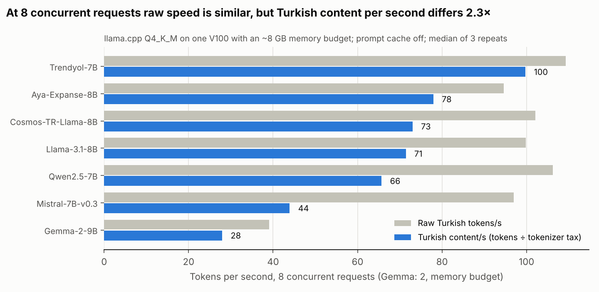

# TR-LLM Bench

How much does Turkish cost to serve on open LLMs, and how much quality does
quantization take away from Turkish compared with English?

**[Leaderboard](https://huggingface.co/spaces/HaticeB/tr-llm-bench)** · **[Eval set](https://huggingface.co/datasets/HaticeB/tr-llm-bench-eval)**

Everything here is measured on parallel TR/EN data with deterministic scoring
(seed 2026, no LLM judge), so the Turkish and English numbers are directly comparable.

## 1. Tokenizer tax

The same FLORES+ sentences take a different number of tokens per language.
**Tax = total Turkish tokens / total English tokens.** Fertility (tokens per word)
is not used because word lengths differ across languages.

| Tokenizer (models sharing it) | TR | FI | HU | DE | FR |
|---|---|---|---|---|---|
| Kumru-2B (Turkish-focused) | 0.64 | 1.49 | 1.69 | 1.48 | 1.52 |
| Trendyol-7B | 1.10–1.22 ¹ | 1.95 | 1.94 | 1.56 | 1.58 |
| Aya-Expanse-8B | 1.21 | 1.93 | 2.08 | 1.32 | 1.33 |
| Gemma-3-12B | 1.36 | 1.66 | 1.67 | 1.32 | 1.40 |
| Gemma-2-9B | 1.40 | 1.61 | 1.66 | 1.25 | 1.35 |
| Llama-3.1-8B / Cosmos-TR-Llama-8B | 1.40 | 1.98 | 2.11 | 1.58 | 1.59 |
| gpt-oss-20b / Phi-4-mini | 1.42 | 1.56 | 1.79 | 1.31 | 1.36 |
| Mistral-Nemo-12B / Ministral-8B | 1.48 | 1.65 | 1.61 | 1.30 | 1.31 |
| Qwen2.5-7B / Qwen3-8B | 1.62 | 1.97 | 2.11 | 1.55 | 1.57 |
| Granite-3.3-8B | 1.72 | 1.87 | 1.91 | 1.61 | 1.62 |
| Phi-4 | 1.92 | 1.99 | 2.14 | 1.58 | 1.59 |
| DeepSeek-V3 | 2.03 | 1.87 | 1.98 | 1.51 | 1.54 |
| Mistral-7B-v0.3 | 2.21 | 2.01 | 2.00 | 1.58 | 1.59 |

Tokens relative to English (English = 1.0) on the same 2,009 sentences. 95% bootstrap intervals
(resampling sentences, paired across languages) are in `results/tokenizer_langs.csv`;
per-sentence token counts (numbers only, no text) in `results/tokenizer_counts.csv.gz`.

A 1.62 tax means the same Turkish content costs 62% more tokens: more latency,
less effective context and lower content throughput. Trendyol's Turkish vocabulary
extension (32,768 → 44,312 tokens) cuts the tax to 1.10, the lowest of the general models.

**The cost is not specific to Turkish.** Turkish needs fewer tokens than the other two
agglutinative languages, Finnish and Hungarian, in 11 of 13 distinct tokenizers (no interval overlaps);
the exceptions are Mistral-7B-v0.3 and DeepSeek-V3. Against German and French the picture is mixed.
This points to the tokenizer's training data rather than morphology alone: a Turkish-focused
tokenizer (Kumru) makes Turkish *cheaper* than English.

¹ *Same tokenizer files (repo unchanged since June 2024), different libraries:* the fast tokenizer in
transformers 4.57.3 gives 1.10, the SentencePiece (slow) tokenizer 1.12, and the earlier run with an
older transformers gave 1.22. On the eval prompts, llama.cpp's tokenizer (which served the model in section 2)
gives 1.10 while transformers on the server gives 1.16 for the same text, so serving numbers use 1.10. Every tokenizer row now records the repo commit, tokenizer class and
library versions. All other tokenizers reproduced exactly.


## 2. Serving performance on a shared V100

Load tests use fixed output length (`min_tokens` + `ignore_eos`, 256 tokens) and streaming TTFT.
Raw tok/s is reported together with **content throughput = tok/s ÷ tax**,
because Turkish tokens carry less content than English ones.

The GPU was shared with a production service. The benchmark ran on one V100 within a budget of
about 8 GB, under a guard that stops it if the other GPUs or the service are disturbed. Peak total
memory on that GPU, service included, stayed at 12.9 GB (planned ceiling 15.5 GB). 138 runs, 0 errors.

**TTFT caveat.** Each run repeats the same prompts, and vLLM's prefix cache is on by default, so after the first
repeat vLLM's time to first token is largely a cache hit. Section 2c re-measures it with the cache off; vLLM
TTFT values in 2a, 2b and 2d were measured with the cache on and understate a cold first token.
Throughput (tok/s) is dominated by the 256-token decode and is not affected in the same way.

### 2a. Seven models, llama.cpp, Q4_K_M

Median of 3 repeats. Three speeds, all for Turkish output:

- **TR tok/s**: raw tokens per second, as the engine reports them.
- **TR words/s (measured)**: words actually generated per second; see note ² before using it.
- **TR content tok/s** = TR tok/s ÷ tokenizer tax: how many English-equivalent tokens of content per second.
  This is the number used for comparisons below.

Cost assumes **$1 per GPU-hour** (scale linearly to your price) at full load, with Turkish words per second
= tokens ÷ Turkish tokens per word on FLORES+.

| Model | c=1 TR tok/s | Top c | TR tok/s | EN tok/s | TR words/s (measured) ² | TR content tok/s | TTFT p50 TR (ms) | GPU 2 peak (GB) | $ per 1k TR words @ $1/h |
|---|---|---|---|---|---|---|---|---|---|
| Trendyol-7B | 35 | 8 | 130 | 123 | 59 | **119** | 427 | 10.3 | 0.0040 |
| Aya-Expanse-8B | 32 | 8 | 109 | 115 | 50 | **90** | 571 | 11.6 | 0.0047 |
| Cosmos-TR-Llama-8B | 34 | 8 | 122 | 126 | 54 | **87** | 493 | 11.3 | 0.0049 |
| Llama-3.1-8B | 34 | 8 | 121 | 123 | 51 | **87** | 636 | 12.4 | 0.0049 |
| Qwen2.5-7B | 34 | 8 | 130 | 130 | 47 | **81** | 249 | 9.9 | 0.0054 |
| Mistral-7B-v0.3 | 35 | 8 | 127 | 128 | 38 | **57** | 683 | 11.0 | 0.0082 |
| Gemma-2-9B | 25 | 2 | 43 | 42 | 4 | **31** | 531 | 12.9 | 0.0139 |

² *Measured words/s is not a content measure in this setup.* Every request is forced to 256 output tokens
(`min_tokens` + `ignore_eos`), so generation continues after the model's natural answer ends, and what it
produces there is often not words. Stored samples (`python -m trbench.eval.queue_report --samples`) confirm
it: Gemma-2-9B answers, then fills the rest of the 256 tokens with newlines (4 words/s from 43 tok/s), while
Trendyol-7B keeps writing, sometimes in a loop. Use content tok/s, not measured words/s, to compare models.



- **Same engine, same GPU, similar raw speed (121–130 tok/s at 8 concurrent requests), yet Turkish
  content per second ranges from 57 to 119.** The tokenizer, not the model size, decides how much
  Turkish a GPU-hour buys: Mistral-7B costs about twice as much per Turkish word as Trendyol.
- Gemma-2-9B runs at 2 concurrent requests: its KV cache (~344 KB per token) does not fit 8 in the budget.
- Trendyol's tax is taken as 1.10: the FLORES+ value with the fast tokenizer, and also what llama.cpp's own
  tokenizer (which served the model) gives on the eval prompts (see note ¹ in section 1).

### 2b. Engine comparison: vLLM vs llama.cpp (Mistral-7B, 4-bit)

Same model, same GPU, same ~8 GB budget, vLLM in eager mode (CUDA graphs need more memory than the budget):

- **llama.cpp** `b12470`, Q4_K_M.
- **vLLM, V100 build, AWQ-int4.** Upstream vLLM rejects AWQ on V100 (it requires compute capability 7.5;
  the V100 is 7.0), so this column comes from a vLLM build patched for V100 and cannot be reproduced with
  a `pip install vllm`.
- **vLLM 0.18.1 (upstream, PyPI), GPTQ-int4** (`RedHatAI/Mistral-7B-Instruct-v0.3-GPTQ-4bit`,
  `--quantization gptq`). The last upstream series that still supports the V100; anyone can reproduce
  this column (`configs/gpu_vllm_upstream_gptq.yaml`).

| Concurrency | Lang | llama.cpp tok/s | vLLM AWQ (V100 build) tok/s | vLLM 0.18.1 GPTQ tok/s | TTFT p50 llama.cpp / AWQ / GPTQ (ms) |
|---|---|---|---|---|---|
| 1 | EN | 36 | 26 | 30 | 89 / 100 / 78 |
| 1 | TR | 35 | 28 | 29 | 117 / 98 / 85 |
| 4 | EN | 85 | 100 | 114 | 218 / 170 / 220 |
| 4 | TR | 76 | 101 | 108 | 328 / 189 / 235 |
| 8 | EN | 128 | 199 | 137 | 560 / 248 / 298 |
| 8 | TR | 127 | 152 | 107 | 683 / **2482** / **2157** |

- **llama.cpp wins for a single user, vLLM wins at 4 requests** (+33–41% Turkish with either vLLM):
  without CUDA graphs vLLM pays a per-step overhead that batching later amortizes.
- **At 8 requests under the tight budget, Turkish loses vLLM's advantage, and this holds on upstream vLLM too.**
  With upstream GPTQ, Turkish throughput (107 tok/s) even falls below llama.cpp (127).
- The vLLM TTFT values in this table were measured with the prefix cache on (see the caveat above): the 0.25–0.3 s
  English first token at 8 requests is a cache hit, while the Turkish one stays at 2.2–2.5 s (likely because its
  longer prompts do not all stay in the small cache), so the two are not comparable. Section 2c gives cold-prefill values for both languages.
- The two vLLM columns differ in both build and 4-bit format, so the gap between them (e.g. 199 vs 137 tok/s
  in English at 8 requests) is not attributable to either alone.
- Only Mistral could be compared: Llama-3.1 and Qwen2.5 AWQ did not start within the budget.
  Their 128k–152k vocabularies keep large embedding and output layers in 16-bit, so loading took
  6.5 GiB and left no room for KV cache (vLLM reported −1.01 GiB available).

### 2c. Why Turkish waits longer: token count, not language

Upstream vLLM 0.18.1, Mistral-7B GPTQ, `gpu_memory_utilization` 0.20, closed-loop load, 5 repeats per cell after a
warm-up, 24 requests per run. **Prefix cache off** (`--no-enable-prefix-caching`), so every repeat pays the full
prefill; the queue is read from vLLM's `/metrics` every 0.25 s (`configs/gpu_6d_mnbt*.yaml`,
`python -m trbench.eval.queue_report --file results/gpu_6d_mnbt.jsonl`).
*Prompt tokens* = natural eval prompts, or both languages cut to exactly 300 tokens with the model's own tokenizer.

| Prompt tokens | Concurrency | EN TTFT p50 (ms) | TR TTFT p50 (ms) | TR / EN | Mean prompt tokens EN / TR |
|---|---|---|---|---|---|
| natural | 4 | 923 | 1599 | 1.73× | 200 / 399 |
| natural | 8 | 1677 | 2340 | 1.40× | 197 / 393 |
| 300 | 4 | 1360 | 1361 | 1.00× | 304 / 304 |
| 300 | 8 | 2341 | 2270 | 0.97× | 304 / 304 |

- **With equal prompt lengths the language difference disappears.** With natural prompts Turkish waits
  1.4–1.7× longer because its prompts have 2× the tokens (the tokenizer tax); cut to 300 tokens each, both
  languages wait the same. Five repeats per cell agree within ±4% at 4 requests.
- **It is not a request queue.** vLLM reported at most 2 waiting requests and no preemptions in any run.
- **It is not the per-step prompt budget.** Raising `--max-num-batched-tokens` from 2048 to 4096 did not shorten
  the Turkish wait at 8 requests (3059 ms, slower), and lowering it to 1024 did not lengthen the English one
  (1309 ms). An earlier version of this README suggested that budget as the cause; this run rules it out.
- **The prefix cache hides the cost.** With the cache on (vLLM's default) and the same prompts repeated, TTFT at
  4 requests drops to ~0.21 s in both languages after the first repeat (first repeat: 0.84 s EN, 1.40 s TR). Real
  traffic rarely repeats whole prompts, so the cold values above are the relevant ones; a shared system prompt
  would sit between the two.
- Polling `/metrics` does not change the result (EN, 4 requests: 920 ms off, 923 ms on).
- These numbers describe ~5–6 GB of vLLM memory on a V100 in eager mode; absolute values will differ elsewhere,
  but the proportionality to prompt tokens is what carries over.

### 2d. Context length on GPU (llama-bench)

Median of 3 repeats per cell; the GPU is shared, and single repeats occasionally dropped
(e.g. 37, 37, 21 tok/s), which the median ignores.

| Model | Decode tok/s, empty context | at 4,096 tokens of context | Change | Prefill tok/s (4,096-token prompt) |
|---|---|---|---|---|
| Aya-Expanse-8B | 33.1 | 30.9 | -7% | 702 |
| Llama-3.1-8B | 35.9 | 33.2 | -8% | 704 |
| Cosmos-TR-Llama-8B | 35.9 | 33.1 | -8% | 703 |
| Mistral-7B-v0.3 | 38.3 | 35.2 | -8% | 705 |
| Trendyol-7B | 37.8 | 34.8 | -8% | 706 |
| Qwen2.5-7B | 37.2 | 33.6 | -10% | 752 |
| Gemma-2-9B | 27.1 | 23.3 | -14% | 436 |

- Decoding with 4,096 tokens already in context is 7–10% slower (Gemma: 14%). Since Turkish needs
  1.1–2.2× more tokens for the same text, it reaches that point sooner.

### 2e. Earlier run on an exclusive GPU (historical)

Qwen2.5-7B-Instruct, vLLM, one V100 32 GB, 256 output tokens per request, median of 3 repeats.
*Provenance:* measured on 16 Nov 2026 with an earlier version of `configs/phase3.yaml`
(GPU memory utilization 0.80, CUDA graphs on). That setting used more memory than the shared
server's budget allows, so the config was retired; these numbers cannot be reproduced from the
current config and are kept as a historical result. Content tok/s = TR tok/s ÷ 1.62.

| Quant | Concurrency | EN tok/s | TR tok/s | TR content tok/s | TTFT p50 EN / TR (ms) |
|---|---|---|---|---|---|
| fp16 | 1 | 15.5 | 15.6 | 9.6 | 84 / 84 |
| fp16 | 4 | 61.0 | 60.6 | 37.4 | 217 / 196 |
| fp16 | 16 | 185.5 | 185.5 | 114.5 | 412 / 404 |
| fp16 | 32 | 273.8 | 265.0 | 163.6 | 540 / 602 |
| AWQ-int4 | 1 | 32.6 | 31.6 | 19.5 | 57 / 60 |
| AWQ-int4 | 4 | 124.6 | 122.7 | 75.7 | 117 / 125 |
| AWQ-int4 | 16 | 352.4 | 315.5 | 194.7 | 261 / 252 |
| AWQ-int4 | 32 | 449.9 | 431.0 | 266.0 | 529 / 554 |

- **The engine is language-neutral, the tokenizer is not.** Raw tok/s is almost identical
  for Turkish and English, yet Turkish users get ~38% less content per second.
- **AWQ-int4 roughly doubles throughput** over fp16 on V100 at every concurrency level
  (single-stream decoding is memory-bound, so 4× smaller weights pay off).
- Qwen2.5-14B AWQ-int4 (Turkish only, partial run): 17.7 tok/s at c=1, 203 tok/s at c=32.

Finding: GPTQ-int8 does not run on V100 (SM70) for models with attention bias
(e.g. Qwen), because the Marlin kernel does not support bias.

## 3. Quantization tax on Turkish quality (llama.cpp, CPU)

550 items: parallel TR/EN reading (Belebele), knowledge (Global-MMLU,
culturally agnostic subset), math (GSM8K / GSM8K-TR), instruction following,
JSON extraction, plus a Turkish-only morphology set.

**Quantization tax = (accuracy loss in TR) − (accuracy loss in EN)** relative to fp16,
with bootstrap 95% confidence intervals.

Seven instruct models, GGUF built from the original weights (Qwen: official GGUF),
llama.cpp `b12470`, CPU, greedy decoding. fp16 accuracy (%, TR / EN), with the 8
mistranslated items removed (see below):

| Model | Reading | Knowledge | Math | Instruction | JSON | Morphology (TR) |
|---|---|---|---|---|---|---|
| Gemma-2-9B | 87 / 95 | 63 / 66 | 97 / 97 | 98 / 85 | 100 / 100 | 88 |
| Qwen2.5-7B | 85 / 95 | 45 / 68 | 79 / 95 | 78 / 75 | 100 / 100 | 64 |
| Aya-Expanse-8B | 84 / 96 | 53 / 63 | 69 / 85 | 70 / 83 | 100 / 100 | 90 |
| Cosmos-TR-Llama-8B | 75 / 96 | 50 / 55 | 69 / 77 | 67 / 77 | 100 / 100 | 88 |
| Llama-3.1-8B | 67 / 91 | 58 / 61 | 79 / 90 | 67 / 97 | 100 / 100 | 66 |
| Trendyol-7B v1.8 | 82 / 78 | 50 / 58 | 36 / 36 | 32 / 18 | 50 / 50 | 86 |
| Mistral-7B-v0.3 | 35 / 87 | 42 / 53 | 23 / 59 | 32 / 60 | 98 / 100 | 64 |


Quantization tax over 242 paired items (percentage points, positive = Turkish loses more,
95% bootstrap CI):

| Model | Q8_0 | Q4_K_M |
|---|---|---|
| Gemma-2-9B | +1.2 [−0.4, +3.3] | −0.0 [−2.5, +2.5] |
| Qwen2.5-7B | +1.2 [−1.7, +4.5] | +1.7 [−2.1, +5.4] |
| Aya-Expanse-8B | +2.1 [−0.8, +5.0] | +0.0 [−4.5, +5.0] |
| Cosmos-TR-Llama-8B | +0.8 [−2.5, +4.1] | −0.8 [−5.4, +3.7] |
| Llama-3.1-8B | −0.8 [−4.5, +2.9] | −1.7 [−7.4, +3.7] |
| Trendyol-7B v1.8 | −0.4 [−2.9, +2.1] | −2.9 [−7.4, +1.2] |
| Mistral-7B-v0.3 | −1.7 [−5.4, +1.7] | −2.5 [−7.4, +2.1] |

- **No measurable quantization tax in any of the seven models.** All 14 intervals include
  zero: down to Q4_K_M, Turkish does not degrade more than English.
- **The language gap is set by the base model, and it varies a lot.** Gemma-2-9B is at
  parity in math and close in knowledge; Qwen2.5-7B trails by 23 points in knowledge;
  Llama-3.1-8B trails by 24 in reading and by 30 in Turkish instruction following;
  Mistral-7B, the model with the worst tokenizer tax (2.21×), is weakest in Turkish overall.
- **Multilingual and Turkish-tuned models lead on morphology:** Aya 90, Gemma 88, Cosmos 88,
  Trendyol 86, against 64–66 for Qwen, Llama and Mistral.
- **Turkish fine-tuning helps Turkish, but can leak into structured output.** Trendyol-7B v1.8
  is the only model better in Turkish than in English at reading (82 vs 78), but half its
  JSON is invalid: it writes Turkish decimal commas (`"birim_fiyat": 3,75`) and Turkish keys
  even when the prompt is English. Cosmos (Llama-3 fine-tuned on Turkish) gains on reading
  and morphology over Llama-3.1-8B without that side effect.
- **Practical traps found along the way:**
  - Trendyol-7B v1.8 (Mistral-based) ships no chat template. llama.cpp silently fell back
    to ChatML and the first run was nonsense; the numbers above come from a re-run with its
    `[INST]` format (`configs/chat_templates/mistral_inst.jinja`). Check the template of
    every converted model; `scripts/queue_models.sh` now refuses to measure a model without one.
  - Aya printed its end-of-turn token (`<|END_OF_TURN_TOKEN|>`) as text, and answered
    multiple choice as a bare letter followed by an explanation. Responses were cut at the
    turn token (identical to a correct stop under greedy decoding; `trbench.eval.rescore`)
    and the scorer was fixed to read a bare letter followed by a newline. All models were
    re-scored with the same rules; only Aya and 4 Gemma items changed.

### Fourteen models on GPU (Q4_K_M)

Same 550 items, llama.cpp on the shared V100 (`scripts/gpu_quality.sh`), greedy decoding.
Seven newer models were added; the seven CPU models were rerun on GPU with the same GGUF files.
Paired items without the 8 translation errors; morphology is Turkish only. With 242 pairs a single
accuracy has a 95% interval of about ±5 points, so neighbours in the table are not distinguishable.

| Model | TR | EN | TR − EN | Morphology | Same result as CPU |
|---|---|---|---|---|---|
| Gemma-2-9B | 90% | 89% | +1 | 88% | 99% |
| Qwen3-8B | 81% | 92% | −11 | 92% | – |
| Qwen2.5-7B | 79% | 88% | −10 | 60% | 98% |
| Qwen3-4B | 77% | 91% | −14 | 70% | – |
| Gemma-3-4B | 76% | 87% | −11 | 88% | – |
| Aya-Expanse-8B | 76% | 86% | −10 | 92% | 97% |
| Llama-3.1-8B | 74% | 85% | −11 | 44% | 95% |
| Phi-4-mini | 70% | 88% | −19 | 64% | – |
| Cosmos-TR-Llama-8B | 70% | 82% | −12 | 84% | 96% |
| Trendyol-7B | 51% | 45% | +6 | 84% | 98% |
| Llama-3.2-3B | 50% | 76% | −26 | 42% | – |
| Granite-3.3-8B | 50% | 87% | −37 | 46% | – |
| Ministral-8B | 48% | 81% | −34 | 72% | – |
| Mistral-7B-v0.3 | 48% | 71% | −23 | 58% | 94% |

- **GPU and CPU agree.** For the seven models measured on both, 94–99% of items get the same
  right/wrong result and accuracy moves by at most 2 points: the quality numbers do not depend on the backend.
- **Size is not the main factor for Turkish.** Gemma-3-4B and Qwen3-4B match or beat 8B models
  (Llama-3.1, Cosmos), while Granite-3.3-8B and Ministral-8B lose 34–37 points from English to Turkish.
- **English accuracy hides the gap.** Granite-3.3-8B is at 87% in English and 50% in Turkish;
  an English benchmark would rank it next to Gemma-3-4B.
- Two runs needed fixes, both documented in the code: Aya-Expanse printed its turn-end token as text
  (cut and rescored, as on CPU), and Qwen3-4B kept reasoning in plain text despite `--reasoning-budget 0`,
  so it was rerun with `enable_thinking=false` (`configs/gpu_quality_rerun.txt`).
  Raw rows: `results/gpu_quality.jsonl`; `python -m trbench.eval.gpu_quality_report` rebuilds the table.

### KV-cache quantization (GPU)

Same Q4_K_M weights, same 550 items, llama.cpp with flash attention; only the KV cache type changes
(`--cache-type-k/v` f16, q8_0, q4_0; `configs/gpu_kvcache.txt`, `configs/gpu_kvcache2.txt`). Memory is the
peak on the benchmark GPU during each run; tax is measured against the f16 cache on 242 paired items, 95% bootstrap CI.

| Model | KV cache | GPU memory (MiB) | TR loss | EN loss | KV tax [95% CI] |
|---|---|---|---|---|---|
| Gemma-2-9B | f16 | 12320 | – | – | – |
| | q8_0 | 11076 | +0.4 | +0.0 | +0.4 [−0.8, +2.1] |
| | q4_0 | 10404 | +0.0 | −1.7 | +1.7 [−0.8, +4.1] |
| Qwen3-8B | f16 | 9736 | – | – | – |
| | q8_0 | 9204 | −0.4 | +0.0 | −0.4 [−1.7, +0.8] |
| | q4_0 | 8916 | +0.4 | −0.8 | +1.2 [−2.9, +5.4] |
| Llama-3.1-8B | f16 | 9568 | – | – | – |
| | q8_0 | 9096 | +0.4 | +2.5 | −2.1 [−5.4, +0.8] |
| | q4_0 | 8840 | +5.4 | −0.4 | +5.8 [+0.4, +11.2] |
| Cosmos-TR-Llama-8B | f16 | 9568 | – | – | – |
| | q4_0 | 8840 | −1.7 | +1.2 | −2.9 [−7.4, +1.2] |
| Llama-3.2-3B | f16 | 6908 | – | – | – |
| | q4_0 | 6272 | +0.0 | −3.3 | +3.3 [−3.7, +10.7] |

- **q8_0 cache is free:** 0.5–1.2 GB less memory and no measurable change in either language.
- **q4_0 cache saves 0.6–1.9 GB and shows no consistent Turkish-specific loss.** Llama-3.1-8B was the one
  exception (Turkish −5.4 points, interval just above zero), so the run was repeated on two models of the same
  family. Neither shows it: Cosmos-TR-Llama-8B (same architecture, Turkish fine-tune) moves the other way, and
  Llama-3.2-3B loses nothing in Turkish. With eight comparisons, one interval excluding zero is what chance
  alone would produce about a third of the time; the Llama-3.1-8B result is best read as noise, not a family effect.
- Like weight quantization to Q4_K_M (section 3), a 4-bit KV cache did not cost Turkish more than English on any
  model in a way that held up. `python -m trbench.eval.kv_report` reproduces the table.

### How much of the gap is the benchmark's fault?

All 38 items that fp16 got wrong in Turkish but right in English were reviewed by hand:
**30 are genuine model errors, 8 are translation errors** that change the meaning of
the Turkish item, and 0 are scoring errors. Examples of meaning-changing errors:

- Belebele-TR: a "not true" option was negated in translation, so it became true;
  "rotation" became "orbit" in the passage but "rotation" in the options;
  "airline" became "airport" in the options.
- Global-MMLU-TR: "EXCEPT" was dropped, reversing the question; "H2O(s)" (solid)
  became "H2O(lar)" (a Turkish plural suffix).
- GSM8K-TR: "200 taps per minute with each foot" became ambiguous ("with both feet").

Turkish–English gap at fp16 after removing those 8 items:

| Category | Raw gap | Corrected gap |
|---|---|---|
| Reading | 16.7 pts | 9.0 pts |
| Knowledge | 27.5 pts | 23.7 pts |
| Math | 17.5 pts | 15.4 pts |

**About half of the reading gap comes from Belebele-TR translation quality, not from the
model.** The knowledge and math gaps are mostly real. Several other items contain term
errors that do not change the answer (e.g. "24 hours" → "24 seconds",
"discount rate" → "indirim oranı" instead of "reeskont oranı").

### Public vs original items

Belebele, Global-MMLU and GSM8K are public and may be in training data; the instruction and JSON items were
generated in this repository and are published nowhere else. TR−EN accuracy gap in points on the GPU run
(Q4_K_M), with 95% paired-bootstrap intervals (`python -m trbench.eval.breakdown`, which also gives per-category intervals):

| Model | Public: TR − EN | Original: TR − EN |
|---|---|---|
| Gemma-2-9B | −6 [−12, −1] | +9 [+4, +15] |
| Qwen3-8B | −14 [−22, −5] | −7 [−13, −3] |
| Qwen2.5-7B | −17 [−26, −10] | +0 [−5, +5] |
| Qwen3-4B | −13 [−20, −5] | −15 [−22, −9] |
| Aya-Expanse-8B | −11 [−20, −3] | −9 [−15, −3] |
| Llama-3.1-8B | −17 [−26, −8] | −4 [−13, +5] |
| Gemma-3-4B | −19 [−28, −10] | −1 [−3, +0] |
| Cosmos-TR-Llama-8B | −16 [−26, −6] | −7 [−14, −2] |
| Phi-4-mini | −20 [−29, −11] | −17 [−25, −10] |
| Trendyol-7B | +2 [−6, +10] | +10 [+5, +17] |
| Llama-3.2-3B | −17 [−26, −8] | −38 [−51, −25] |
| Ministral-8B | −31 [−42, −20] | −37 [−47, −27] |
| Granite-3.3-8B | −43 [−52, −34] | −30 [−39, −22] |
| Mistral-7B-v0.3 | −33 [−43, −23] | −11 [−18, −4] |

- **The Turkish gap is not only a benchmark artefact:** 9 of 14 models also trail in Turkish on items no model
  can have seen, by up to 38 points.
- **For most models the gap is larger on public benchmarks** (e.g. Qwen2.5-7B −17 vs 0, Gemma-3-4B −19 vs −1),
  consistent with the translation errors above; contamination may add to it, but these data cannot separate the two.
- Gemma-2-9B and Trendyol-7B do better in Turkish than English on the original items, driven by instruction following.

## 4. Quality vs. speed on CPU

`llama-bench` (llama.cpp `b12470`, 16 cores, 128 generated tokens, 3 repeats) on every GGUF,
with **Turkish content throughput = tok/s ÷ tokenizer tax** and Turkish accuracy over the
paired categories (mistranslated items removed).


Q4_K_M, the fastest setting of each model:

| Model (Q4_K_M) | CPU tok/s | TR content tok/s | TR accuracy % |
|---|---|---|---|
| **Gemma-2-9B** | 8.7 | 6.2 | 89 |
| Qwen2.5-7B | 9.2 | 5.7 | 79 |
| **Aya-Expanse-8B** | 10.9 | 9.0 | 76 |
| Llama-3.1-8B | 11.7 | 8.4 | 74 |
| Cosmos-TR-Llama-8B | 11.9 | 8.5 | 72 |
| Trendyol-7B v1.8 | 12.5 | 11.3 | 50 |
| Mistral-7B-v0.3 | 13.0 | 5.9 | 46 |

- **Q4_K_M costs at most 1 point of Turkish accuracy in every model** and is its fastest
  setting.
- **Gemma-2-9B Q4_K_M is the most accurate; Aya-Expanse-8B and Trendyol-7B Q4_K_M are the other points on the
  quality–speed frontier** (9.0 Turkish content tok/s at 76%, and the most Turkish content per second, 11.3, at 50%).
- Raw speed is not content speed: Mistral-7B is the fastest model in tokens (13.0 tok/s) but
  its 2.21× tax leaves it among the slowest in Turkish content (5.9).
- fp16 CPU speed depends on memory placement: Cosmos and Mistral fp16 measured 2.5 and
  2.7 tok/s, twice repeated, while their same-architecture twins (Llama, Trendyol) ran
  at 4.1–4.2 and all four match within 0.4 tok/s at Q8_0 and Q4_K_M. Compare models at
  Q8_0 or Q4_K_M.

### Input length

Q4_K_M, 16 cores. Prompt reading at 256 / 1,024 / 4,096 tokens, and generation with an
empty vs a 4,096-token context:

| Model | Read 256 | Read 1k | Read 4k (tok/s) | Generate, empty | Generate, 4k context |
|---|---|---|---|---|---|
| Qwen2.5-7B | 65.7 | 64.7 | 58.0 | 11.4 | 8.3 |
| Gemma-2-9B | 50.6 | 48.5 | 41.9 | 8.8 | 5.6 |
| Llama-3.1-8B | 62.3 | 60.2 | 52.6 | 11.9 | 8.3 |
| Trendyol-7B v1.8 | 62.1 | 59.7 | 53.6 | 12.9 | 7.9 |

Reading slows by 12–17% from 256 to 4,096 tokens; generation slows by 27–39% once 4,096
tokens sit in the context. Because the same Turkish text takes 1.2–2.2× the tokens, a
Turkish conversation reaches that slower regime sooner than an English one: the tokenizer
tax is paid again in long contexts.

## Summary

For a Turkish user of open 7–9B models: the engine serves Turkish as fast as English in
tokens, but the tokenizer decides how much Turkish content a GPU-hour delivers (57 to 119
content tok/s on the same GPU, a 2× cost difference per Turkish word) and, in our 8 GB-budget vLLM
runs with Mistral-7B, how long users wait for the first token (1.4–1.7× longer in Turkish with Mistral-7B on vLLM, cache off,
and equal once prompts have the same token count); quantization down to Q4_K_M costs Turkish no more than English in any of
seven models, and neither does a q8_0 or q4_0 KV cache; across fourteen models, Turkish accuracy ranges from 48% to 90% and does not follow
model size (4B Gemma-3 and Qwen3 beat several 8B models); and the remaining quality gap lies in the base model (small for Gemma-2-9B,
large for Llama-3.1-8B and Mistral-7B), partly inflated by translated benchmarks.

Data-quality notes found while inspecting failures: translationese in Belebele-TR,
meaning errors in GSM8K-TR, term errors in Global-MMLU-TR.

## Limitations

**What was measured.** 4–9B open models; quality on 550 items (242 TR/EN pairs after removing 8 translation
errors, plus 50 Turkish-only morphology items), greedy decoding, one run per configuration, llama.cpp `b12470`.
Serving on one shared V100 (SM70) within ~8 GB: 4-bit models, at most 8 concurrent requests (Gemma-2-9B: 2),
closed-loop load (a new request starts when one finishes), fixed 256-token outputs.

**Observed (holds within that setup):**
- Tokenizer tax across 13 tokenizers, and that it sets Turkish content per second on the same engine and GPU.
- No measurable Turkish-specific loss from Q8_0 / Q4_K_M weights (7 models) or from a q8_0 / q4_0 KV cache
  (5 models). 242 pairs give intervals of roughly ±4–6 points: a smaller effect cannot be excluded.
- Turkish trails English on most models both on translated public benchmarks and on the original items
  written for this project (see *Public vs original items*), so the gap is not only contamination or translation.
- With vLLM's prefix cache off, Mistral-7B's Turkish time to first token is 1.4–1.7× the English one at 4–8
  concurrent requests, and the difference disappears when both prompts have the same number of tokens
  (section 2c). Neither a request queue, preemption nor the per-step prompt budget explains it.

**Interpreted (likely, not proven here):**
- Part of the larger gap on public benchmarks comes from translation quality (8 confirmed errors) and possibly
  from contamination; this cannot be separated from item difficulty with the current data.

**Not generalizable from these data:**
- Absolute speeds, the engine ranking and the TTFT numbers beyond a V100 with ~8 GB.
- vLLM TTFT values in sections 2a, 2b and 2d (prefix cache on, repeated prompts); only section 2c measures a cold
  first token.
- Models above 9B, fp16/Q8 serving, high concurrency and open-loop (arrival-rate) traffic.
- Per-category differences: with 40–60 items per category the intervals are wide (up to ±18 points for knowledge).

Other limits: the engine comparison covers only Mistral-7B (the only 4-bit vLLM model that fit), with vLLM in
eager mode; upstream vLLM runs on the V100 only up to 0.18.x and without AWQ. GGUF files are built from the
original weights with llama.cpp `b12470` (Qwen and the newer models: published GGUF files).

Eval set: [HaticeB/tr-llm-bench-eval](https://huggingface.co/datasets/HaticeB/tr-llm-bench-eval)
(original items, IDs of third-party items, translation errata).

## Reproduce

```bash
pip install -e ".[dev,tok]"
pytest -q
python -m trbench.tokenizer_tax.fertility
python -m trbench.eval.build
bash scripts/phase4_cpu.sh Qwen/Qwen2.5-7B-Instruct-GGUF qwen2.5-7b
python -m trbench.eval.analysis --model qwen2.5-7b
# GPU (on the server): bash scripts/gpu_bench.sh configs/gpu_llamacpp.yaml, then
python -m trbench.eval.gpu_report
```

Every result row records where it came from: `git_commit` (and `git_dirty`), the SHA-256 of
the eval set and of the GGUF file, the engine build, and `fp`, a hash of every setting that
changes the result (max tokens, context, template, engine flags), and `exp`, an experiment ID built from
`fp`, the eval-set SHA, the weights SHA or model revision, the engine version and the git commit. A rerun
skips only rows with the same `exp`, and the reports use the latest experiment per model, so changing a
setting, the data or the code never silently reuses an old measurement.

The measurement environment is pinned in `env/`: `SYSTEM.md` (OS, CPU, RAM, GPU, driver, CUDA, llama.cpp
commit) and `pip freeze` lock files for the measurement venv and for upstream vLLM
(`bash scripts/env_snapshot.sh` regenerates them).
`python -m trbench.eval.audit_pairs` checks that each GSM8K TR/EN pair contains the same numbers:
36 of 40 match exactly; the other 4 were read by hand and are correct pairs written differently
(13:00 vs 1 PM, %25 vs 0.25, $1.00 vs 1, "ikişer" vs "2").

The benchmark ran on a shared server. `trbench.guard` watches the other GPUs and a
health endpoint (`TRBENCH_SERVICE_HEALTH`) and stops the run if it disturbs anything.
It checks every 30 s and stops after 2 consecutive violations, so it reacts within about
a minute; `scripts/gpu_bench.sh` also stops the benchmark if the guard process itself dies.

## License

Code: MIT (see `LICENSE`). Third-party benchmark items keep their own licenses and are not
redistributed; the dataset card lists them.
