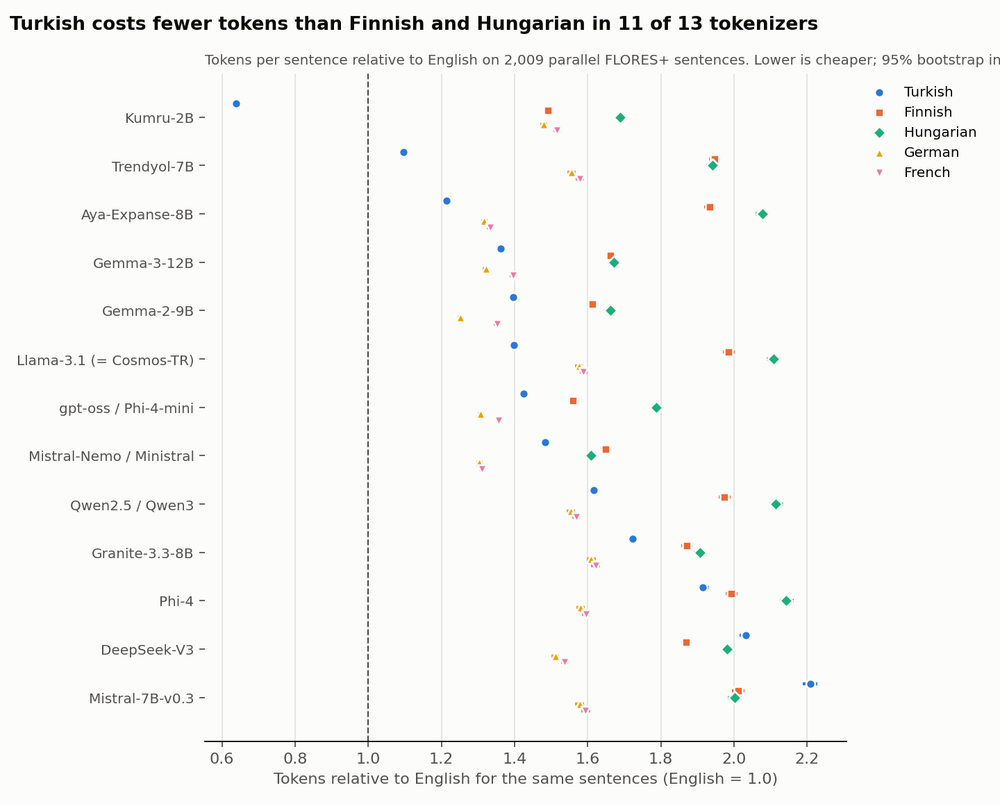

# TR-LLM Bench

[English](README.md) · **Türkçe**

Açık LLM'lerde Türkçe hizmet vermenin maliyeti nedir ve kuantizasyon Türkçenin kalitesinden
İngilizceye kıyasla ne kadar götürür?

**[Leaderboard](https://huggingface.co/spaces/HaticeB/tr-llm-bench)** · **[Değerlendirme seti](https://huggingface.co/datasets/HaticeB/tr-llm-bench-eval)**

Buradaki her şey paralel TR/EN veri üzerinde, deterministik puanlamayla (seed 2026, LLM hakem yok)
ölçüldü; bu yüzden Türkçe ve İngilizce sayılar doğrudan karşılaştırılabilir.

Bu sayfa İngilizce README'nin çevirisidir. İkisi arasında fark çıkarsa İngilizce sürüm esastır.

## 1. Tokenizer vergisi

Aynı FLORES+ cümleleri her dilde farklı sayıda token tutuyor.
**Vergi = toplam Türkçe token / toplam İngilizce token.** Kelime başına token (fertility)
kullanılmıyor, çünkü kelime uzunlukları diller arasında farklı.

| Tokenizer (onu paylaşan modeller) | TR | FI | HU | DE | FR |
|---|---|---|---|---|---|
| Kumru-2B (Türkçe odaklı) | 0,64 | 1,49 | 1,69 | 1,48 | 1,52 |
| Trendyol-7B | 1,10–1,22 ¹ | 1,95 | 1,94 | 1,56 | 1,58 |
| Aya-Expanse-8B | 1,21 | 1,93 | 2,08 | 1,32 | 1,33 |
| Gemma-3-12B | 1,36 | 1,66 | 1,67 | 1,32 | 1,40 |
| Gemma-2-9B | 1,40 | 1,61 | 1,66 | 1,25 | 1,35 |
| Llama-3.1-8B / Cosmos-TR-Llama-8B | 1,40 | 1,98 | 2,11 | 1,58 | 1,59 |
| gpt-oss-20b / Phi-4-mini | 1,42 | 1,56 | 1,79 | 1,31 | 1,36 |
| Mistral-Nemo-12B / Ministral-8B | 1,48 | 1,65 | 1,61 | 1,30 | 1,31 |
| Qwen2.5-7B / Qwen3-8B | 1,62 | 1,97 | 2,11 | 1,55 | 1,57 |
| Granite-3.3-8B | 1,72 | 1,87 | 1,91 | 1,61 | 1,62 |
| Phi-4 | 1,92 | 1,99 | 2,14 | 1,58 | 1,59 |
| DeepSeek-V3 | 2,03 | 1,87 | 1,98 | 1,51 | 1,54 |
| Mistral-7B-v0.3 | 2,21 | 2,01 | 2,00 | 1,58 | 1,59 |

Aynı 2.009 cümlede İngilizceye göre token sayısı (İngilizce = 1,0). %95 bootstrap aralıkları
(cümleler yeniden örneklenerek, diller arasında eşleştirilmiş) `results/tokenizer_langs.csv` dosyasında;
cümle başına token sayıları (yalnızca sayılar, metin yok) `results/tokenizer_counts.csv.gz` dosyasında.

1,62'lik bir vergi, aynı Türkçe içeriğin %62 daha fazla token tuttuğu anlamına gelir: daha uzun gecikme,
daha az kullanılabilir bağlam ve daha düşük içerik hızı. Trendyol'un Türkçe kelime dağarcığı
genişletmesi (32.768 → 44.312 token) vergiyi 1,10'a indiriyor; bu, genel modeller arasında en düşük değer.

**Bu maliyet Türkçeye özgü değil.** Türkçe, diğer iki eklemeli dil olan Fince ve Macarcadan
13 farklı tokenizer'ın 11'inde daha az token tutuyor (aralıklar çakışmıyor); istisnalar
Mistral-7B-v0.3 ve DeepSeek-V3. Almanca ve Fransızcaya karşı tablo karışık. Bu, tek başına
morfolojiden çok tokenizer'ın eğitim verisine işaret ediyor: Türkçe odaklı bir tokenizer (Kumru),
Türkçeyi İngilizceden *daha ucuz* hale getiriyor.

¹ *Aynı tokenizer dosyaları (repo Haziran 2024'ten beri değişmedi), farklı kütüphaneler:* transformers
4.57.3'teki hızlı tokenizer 1,10, SentencePiece (yavaş) tokenizer 1,12 veriyor; daha eski bir
transformers sürümüyle yapılan önceki koşu 1,22 vermişti. Değerlendirme prompt'larında llama.cpp'nin
tokenizer'ı (modeli 2. bölümde sunan) 1,10, sunucudaki transformers ise aynı metin için 1,16 veriyor;
bu yüzden servis sayılarında 1,10 kullanılıyor. Artık her tokenizer satırı repo commit'ini, tokenizer
sınıfını ve kütüphane sürümlerini kaydediyor. Diğer bütün tokenizer'lar birebir aynı sonucu verdi.




## 2. Paylaşılan bir V100'de servis performansı

Yük testlerinde çıktı uzunluğu sabit (`min_tokens` + `ignore_eos`, 256 token) ve ilk token süresi (TTFT)
streaming ile ölçülüyor. Ham tok/s, **içerik hızı = tok/s ÷ vergi** ile birlikte veriliyor, çünkü Türkçe
token'lar İngilizce token'lardan daha az içerik taşıyor.

GPU bir üretim servisiyle paylaşılıyordu. Benchmark, tek bir V100'de yaklaşık 8 GB'lık bir bütçe içinde,
diğer GPU'lar ya da servis etkilenirse onu durduran bir koruyucu (guard) altında çalıştı. O GPU'daki toplam
bellek, servis dahil, en fazla 12,9 GB'a çıktı (planlanan tavan 15,5 GB). 138 koşu, 0 hata.

**Prompt önbelleği uyarısı.** Her koşu aynı prompt'ları tekrarlıyor ve iki motor da prompt'ları varsayılan
olarak önbelleğe alıyor (vLLM'de prefix cache; llama-server'da istek başına `cache_prompt`). Bu yüzden ilk
tekrardan sonra ilk token süresi büyük ölçüde önbellekten geliyor ve llama.cpp'nin hızı 4–8 istekte
%15–35 yüksek çıkıyor. 2a, 2b (*Soğuk önbellek*) ve 2c bölümleri önbellek kapalıyken ölçüldü. 2b'deki
ilk tablo ve 2e'deki tarihsel vLLM koşusu önbellek açıkken ölçüldü: buradaki TTFT değerleri soğuk ilk
token süresinin altında kalıyor (llama.cpp'de 4–8 kat). 2d bölümü `llama-bench` kullanıyor; onda prompt
önbelleği yok.

### 2a. Yedi model, llama.cpp, Q4_K_M

3 tekrarın medyanı, **prompt önbelleği kapalı** (istek başına `cache_prompt: false`,
`configs/gpu_llamacpp_cold.yaml`, `results/gpu_llamacpp_cold.jsonl`); yani her istek prompt'unu baştan
işliyor (prefill). Üç hız var, hepsi Türkçe çıktı için:

- **TR tok/s**: motorun bildirdiği ham saniyede token sayısı.
- **TR kelime/s (ölçülen)**: saniyede gerçekten üretilen kelime; kullanmadan önce ² numaralı nota bakın.
- **TR içerik tok/s** = TR tok/s ÷ tokenizer vergisi: saniyede kaç İngilizce token karşılığı içerik üretildiği.
  Aşağıdaki karşılaştırmalarda kullanılan sayı bu.

Maliyet, tam yükte **GPU saati başına 1 $** varsayımıyla hesaplandı (kendi fiyatınıza doğrusal
ölçekleyin); saniyede Türkçe kelime = token ÷ FLORES+'ta Türkçe kelime başına token.

| Model | c=1 TR tok/s | En yüksek c | TR tok/s | EN tok/s | TR kelime/s (ölçülen) ² | TR içerik tok/s | TTFT p50 TR (ms) | GPU 2 tepe (GB) | 1.000 TR kelime başına $ (saati 1 $) |
|---|---|---|---|---|---|---|---|---|---|
| Trendyol-7B | 35 | 8 | 109 | 110 | 50 | **100** | 3954 | 9,7 | 0,0047 |
| Aya-Expanse-8B | 31 | 8 | 95 | 97 | 43 | **78** | 3956 | 10,4 | 0,0054 |
| Cosmos-TR-Llama-8B | 33 | 8 | 102 | 107 | 46 | **73** | 4027 | 10,0 | 0,0058 |
| Llama-3.1-8B | 33 | 8 | 100 | 105 | 42 | **71** | 4324 | 12,4 | 0,0060 |
| Qwen2.5-7B | 34 | 8 | 106 | 114 | 39 | **66** | 3734 | 9,0 | 0,0066 |
| Mistral-7B-v0.3 | 34 | 8 | 97 | 112 | 29 | **44** | 4764 | 9,7 | 0,0107 |
| Gemma-2-9B | 24 | 2 | 39 | 40 | 3 | **28** | 1547 | 12,9 | 0,0152 |

² *Bu kurulumda ölçülen kelime/s bir içerik ölçüsü değil.* Her istek 256 çıktı token'ına zorlanıyor
(`min_tokens` + `ignore_eos`); bu yüzden üretim, modelin doğal cevabı bittikten sonra da sürüyor ve o
kısımda üretilen şey çoğu zaman kelime olmuyor. Kaydedilen örnekler
(`python -m trbench.eval.queue_report --samples`) bunu doğruluyor: Gemma-2-9B cevabını verip 256 token'ın
geri kalanını satır sonlarıyla dolduruyor (43 tok/s'den 4 kelime/s), Trendyol-7B ise yazmaya devam
ediyor, bazen döngüye giriyor. Modelleri karşılaştırmak için ölçülen kelime/s'yi değil, içerik tok/s'yi kullanın.


- **Aynı motor, aynı GPU, birbirine yakın ham hız (8 eşzamanlı istekte 95–109 tok/s), ama saniyede
  Türkçe içerik 44 ile 100 arasında değişiyor.** Bir GPU saatinin ne kadar Türkçe ürettiğini model
  boyutu değil tokenizer belirliyor: Mistral-7B'de Türkçe kelime başı maliyet Trendyol'un 2,3 katı.
- **Prompt önbelleği bunun bir kısmını gizlemişti.** llama-server'ın varsayılan önbelleğiyle yapılan
  önceki koşu 121–130 tok/s ve 57–119 içerik tok/s vermişti. Önbelleği kapatmak Türkçe hızın %8–23'ünü
  götürüyor; en çok da tokenizer vergisi en yüksek olan Mistral-7B'de (127 → 97 tok/s). Bu yüzden
  modeller arasındaki fark açılıyor.
- Gemma-2-9B 2 eşzamanlı istekle çalışıyor: KV önbelleği (token başına ~344 KB) 8 istek için bütçeye sığmıyor.
- Trendyol'un vergisi 1,10 olarak alındı: hızlı tokenizer ile FLORES+ değeri; modeli sunan llama.cpp'nin
  kendi tokenizer'ının değerlendirme prompt'larında verdiği değer de bu (1. bölümdeki ¹ numaralı nota bakın).

### 2b. Motor karşılaştırması: vLLM ve llama.cpp (Mistral-7B, 4-bit)

Aynı model, aynı GPU, aynı ~8 GB bütçe; vLLM eager modda (CUDA graph'lar bütçeden fazla bellek istiyor):

- **llama.cpp** `b12470`, Q4_K_M.
- **vLLM, V100 derlemesi, AWQ-int4.** Resmî (upstream) vLLM, V100'de AWQ'yu reddediyor (compute capability
  7.5 istiyor; V100 7.0). Bu yüzden bu sütun V100 için yamalanmış bir vLLM derlemesinden geliyor ve
  `pip install vllm` ile yeniden üretilemez.
- **vLLM 0.18.1 (upstream, PyPI), GPTQ-int4** (`RedHatAI/Mistral-7B-Instruct-v0.3-GPTQ-4bit`,
  `--quantization gptq`). V100'ü hâlâ destekleyen son upstream seri; bu sütunu herkes yeniden üretebilir
  (`configs/gpu_vllm_upstream_gptq.yaml`).

| Eşzamanlı istek | Dil | llama.cpp tok/s | vLLM AWQ (V100 derlemesi) tok/s | vLLM 0.18.1 GPTQ tok/s | TTFT p50 llama.cpp / AWQ / GPTQ (ms) |
|---|---|---|---|---|---|
| 1 | EN | 36 | 26 | 30 | 89 / 100 / 78 |
| 1 | TR | 35 | 28 | 29 | 117 / 98 / 85 |
| 4 | EN | 85 | 100 | 114 | 218 / 170 / 220 |
| 4 | TR | 76 | 101 | 108 | 328 / 189 / 235 |
| 8 | EN | 128 | 199 | 137 | 560 / 248 / 298 |
| 8 | TR | 127 | 152 | 107 | 683 / **2482** / **2157** |

- **Önbellekler açıkken tek kullanıcıda llama.cpp, 4 istekte vLLM önde** (iki vLLM ile de Türkçede
  +%33–41): CUDA graph'lar olmadan vLLM her adımda bir ek yük ödüyor; bu yük, istekler toplu işlendikçe dağılıyor.
- **Dar bütçede 8 istekte Türkçe, vLLM'in avantajını kaybediyor; bu upstream vLLM'de de geçerli.**
  Upstream GPTQ ile Türkçe hız (107 tok/s) llama.cpp'nin (127) bile altına düşüyor.
- Bu tablodaki vLLM TTFT değerleri prefix cache açıkken ölçüldü (yukarıdaki uyarıya bakın): 8 istekte
  İngilizcedeki 0,25–0,3 sn'lik ilk token önbellekten geliyor, Türkçe ise 2,2–2,5 sn'de kalıyor (büyük
  ihtimalle daha uzun prompt'ların hepsi küçük önbellekte tutulamadığı için). Yani ikisi karşılaştırılamaz.
  İki dil için soğuk prefill değerleri 2c bölümünde.
- İki vLLM sütunu hem derleme hem de 4-bit format bakımından farklı; bu yüzden aralarındaki fark (ör. 8
  istekte İngilizcede 199 ve 137 tok/s) tek başına ikisinden birine bağlanamaz.
- Yalnızca Mistral karşılaştırılabildi: Llama-3.1 ve Qwen2.5 AWQ bütçe içinde başlamadı. 128k–152k'lık
  kelime dağarcıkları büyük embedding ve çıkış katmanlarını 16-bit'te tutuyor; yükleme 6,5 GiB tuttu ve
  KV önbelleğine yer kalmadı (vLLM kullanılabilir alanı −1,01 GiB olarak bildirdi).

#### Soğuk önbellek: prompt önbelleği kapalıyken Mistral-7B

Yukarıdaki tablo iki motorun da prompt önbelleği açıkken ölçüldü. Önbellek kapalıyken yeniden ölçüldü
(llama.cpp: istek başına `cache_prompt: false`, `configs/gpu_llamacpp_nocache.yaml`; vLLM 0.18.1 GPTQ:
`--no-enable-prefix-caching`, `configs/gpu_6d_mnbt2048.yaml`), hücre başına 5 tekrar, doğal değerlendirme prompt'ları:

| Eşzamanlı istek | Dil | llama.cpp tok/s | vLLM 0.18.1 GPTQ tok/s | TTFT p50 llama.cpp / vLLM (ms) |
|---|---|---|---|---|
| 1 | EN | 35 | – | 521 / – |
| 1 | TR | 34 | – | 708 / – |
| 4 | EN | 74 | 105 | 1999 / 923 |
| 4 | TR | 48 | 94 | 2988 / 1599 |
| 8 | EN | 113 | 126 | 3550 / 1677 |
| 8 | TR | 97 | 108 | 4537 / 2340 |

- **Soğuk ölçümde vLLM, 4 ve 8 istekte iki dilde de önde.** 4 istekte Türkçenin 2 kat uzun prompt'ları
  llama.cpp'nin hızının %35'ini (48'e karşı 74 tok/s), vLLM'in ise %10'unu (94'e karşı 105) götürüyor;
  8 istekte ikisi de %14 kaybediyor.
- **Soğuk ilk token, yukarıdaki önbellekli değerlerden 4–8 kat uzun sürüyor;** llama.cpp'de Türkçe,
  İngilizceden 1,3–1,5 kat daha uzun bekliyor. Bu, vLLM'deki sonuçla uyumlu (2c bölümü).
- vLLM, önbellek kapalıyken 1 istekte ölçülmedi. Aynı gün önbellek açıkken yapılan llama.cpp koşusu
  yukarıdaki deseni tekrarladı (ilk tekrardan sonra TTFT 87–711 ms), ama 4 istekte Türkçe hızı önceki
  koşudaki gibi 76 değil 55 tok/s çıktı; bu fark açıklanamadı.

### 2c. Türkçe neden daha uzun bekliyor: dil değil, token sayısı

Upstream vLLM 0.18.1, Mistral-7B GPTQ, `gpu_memory_utilization` 0.20, kapalı döngü yük, ısınma turundan
sonra hücre başına 5 tekrar, koşu başına 24 istek. **Prefix cache kapalı** (`--no-enable-prefix-caching`),
yani her tekrar prefill'in tamamını ödüyor; kuyruk 0,25 sn'de bir vLLM'in `/metrics` uç noktasından
okunuyor (`configs/gpu_6d_mnbt*.yaml`, `python -m trbench.eval.queue_report --file results/gpu_6d_mnbt.jsonl`).
*Prompt token'ları* = doğal değerlendirme prompt'ları, ya da iki dilde de modelin kendi tokenizer'ıyla
tam 300 token'a kesilmiş prompt'lar.

| Prompt token'ları | Eşzamanlı istek | EN TTFT p50 (ms) | TR TTFT p50 (ms) | TR / EN | Ortalama prompt token'ı EN / TR |
|---|---|---|---|---|---|
| doğal | 4 | 923 | 1599 | 1,73× | 200 / 399 |
| doğal | 8 | 1677 | 2340 | 1,40× | 197 / 393 |
| 300 | 4 | 1360 | 1361 | 1,00× | 304 / 304 |
| 300 | 8 | 2341 | 2270 | 0,97× | 304 / 304 |

- **Prompt uzunlukları eşit olunca dil farkı ortadan kalkıyor.** Doğal prompt'larda Türkçe 1,4–1,7 kat
  daha uzun bekliyor, çünkü prompt'ları 2 kat daha fazla token tutuyor (tokenizer vergisi); ikisi de 300
  token'a kesilince iki dil aynı süre bekliyor. 4 istekte hücre başına beş tekrar ±%4 içinde tutarlı.
- **Sebep bir istek kuyruğu değil.** vLLM hiçbir koşuda 2'den fazla bekleyen istek ve hiç preemption bildirmedi.
- **Sebep adım başına prompt bütçesi de değil.** `--max-num-batched-tokens` değerini 2048'den 4096'ya
  çıkarmak 8 istekte Türkçe beklemeyi kısaltmadı (3059 ms, daha yavaş); 1024'e indirmek de İngilizce
  beklemeyi uzatmadı (1309 ms). Bu README'nin önceki bir sürümü sebep olarak bu bütçeyi öne sürmüştü; bu koşu onu dışarıda bırakıyor.
- **Prefix cache maliyeti gizliyor.** Önbellek açıkken (vLLM'in varsayılanı) ve aynı prompt'lar
  tekrarlanınca, 4 istekte TTFT ilk tekrardan sonra iki dilde de ~0,21 sn'ye düşüyor (ilk tekrar:
  İngilizce 0,84 sn, Türkçe 1,40 sn). Gerçek trafikte prompt'ların tamamı nadiren tekrarlanır; bu yüzden
  ilgili olan yukarıdaki soğuk değerler. Ortak bir sistem prompt'u ikisinin arasında bir yere düşer.
- `/metrics`'i sorgulamak sonucu değiştirmiyor (İngilizce, 4 istek: kapalıyken 920 ms, açıkken 923 ms).
- Bu sayılar, eager modda bir V100'de ~5–6 GB'lık vLLM belleğini anlatıyor; mutlak değerler başka
  ortamlarda farklı olur, ama genellenebilen şey prompt token sayısıyla orantı.

### 2d. GPU'da bağlam uzunluğu (llama-bench)

Hücre başına 3 tekrarın medyanı; GPU paylaşımlı ve tek tek tekrarlar ara sıra düştü
(ör. 37, 37, 21 tok/s), medyan bunu dikkate almıyor.

| Model | Üretim tok/s, boş bağlam | 4.096 token bağlamla | Değişim | Prefill tok/s (4.096 token'lık prompt) |
|---|---|---|---|---|
| Aya-Expanse-8B | 33,1 | 30,9 | −%7 | 702 |
| Llama-3.1-8B | 35,9 | 33,2 | −%8 | 704 |
| Cosmos-TR-Llama-8B | 35,9 | 33,1 | −%8 | 703 |
| Mistral-7B-v0.3 | 38,3 | 35,2 | −%8 | 705 |
| Trendyol-7B | 37,8 | 34,8 | −%8 | 706 |
| Qwen2.5-7B | 37,2 | 33,6 | −%10 | 752 |
| Gemma-2-9B | 27,1 | 23,3 | −%14 | 436 |

- Bağlamda zaten 4.096 token varken üretim %7–10 daha yavaş (Gemma: %14). Türkçe aynı metin için
  1,1–2,2 kat daha fazla token gerektirdiğinden bu noktaya daha erken ulaşıyor.

### 2d+. Bağlam penceresi vergisi (aynı içerik, EN ve TR uzunluğunda)

Aynı metin Türkçede vergi katı kadar fazla token tutuyor. Bu yüzden her modeli İngilizce
uzunlukta (E) ve Türkçe uzunlukta (E × vergi) ölçtük (llama-bench, Q4_K_M, GPU, 3 tekrarın
medyanı). Gemma-2-9B yalnızca E = 1.024'te ölçüldü: daha uzun Türkçe bağlam 7,5 GB'lık bütçeye
sığmıyor. Veri: `results/gpu_context.jsonl`, tablo: `python -m trbench.eval.context_tax`.

4.096 İngilizce token'lık içerik:

| Model | Vergi | TR token | KV önbelleği EN / TR (MB) | 8.192 token'lık pencereye sığan içerik (EN token) | Üretim tok/s EN / TR | Değişim | Prefill EN / TR (sn) |
|---|---|---|---|---|---|---|---|
| Trendyol-7B | 1,10 | 4.489 | 512 / 561 | 7.475 | 34,9 / 34,8 | −%0 | 5,8 / 6,5 |
| Aya-Expanse-8B | 1,21 | 4.973 | 512 / 622 | 6.747 | 31,0 / 30,7 | −%1 | 5,8 / 7,3 |
| Cosmos-TR-Llama-8B | 1,40 | 5.726 | 512 / 716 | 5.860 | 33,3 / 32,7 | −%2 | 5,8 / 8,7 |
| Llama-3.1-8B | 1,40 | 5.726 | 512 / 716 | 5.860 | 33,3 / 32,7 | −%2 | 5,8 / 8,7 |
| Qwen2.5-7B | 1,62 | 6.625 | 224 / 362 | 5.065 | 33,6 / 31,5 | −%6 | 5,4 / 9,3 |
| Mistral-7B-v0.3 | 2,21 | 9.044 | 512 / 1.130 | 3.710 | 35,5 / 33,0 | −%7 | 5,8 / 14,3 |

1.024 İngilizce token'da desen aynı, etki daha küçük (üretim −%0 ile −%3 arası; Gemma-2-9B:
26,4 / 25,9 tok/s, −%2, prefill 1,9 / 2,8 sn).

- **En büyük maliyet pencere.** 8.192 token'lık pencere, Mistral-7B ile ancak 3.710 İngilizce
  token'a denk Türkçe içerik alıyor; Trendyol-7B ile 7.475. Uzun belge ve RAG prompt'ları sınıra
  vergi katı kadar erken ulaşıyor.
- **Prefill en az vergi oranında büyüyor.** Mistral-7B aynı içeriği Türkçede 2,5 kat yavaş
  okuyor (14,3 ve 5,8 sn); bu 2,21'lik token oranından biraz fazla, çünkü dikkat (attention)
  maliyeti uzunlukla artıyor. Bu fark doğrudan ilk token süresine ekleniyor.
- **KV belleği vergi oranında büyüyor** (Mistral: 4K token'lık istek başına 0,5 GB yerine 1,1 GB).
  Aynı GPU'da daha az eşzamanlı istek demek.
- **Token başına üretim hızı neredeyse değişmiyor** (%0–7). Türkçenin üretim maliyeti büyük ölçüde
  daha fazla token gerektirmesinden geliyor (bölüm 2a), token'ların tek tek yavaşlamasından değil.
- Cosmos-TR-Llama-8B ve Llama-3.1-8B aynı sayıları veriyor: mimari, tokenizer ve dosya boyutu aynı,
  yani yapılan iş de aynı.

### 2e. Özel (paylaşımsız) bir GPU'da önceki koşu (tarihsel)

Qwen2.5-7B-Instruct, vLLM, tek bir 32 GB V100, istek başına 256 çıktı token'ı, 3 tekrarın medyanı.
*Kaynak:* 16 Kasım 2026'da `configs/phase3.yaml`'ın önceki bir sürümüyle ölçüldü (GPU bellek kullanımı
0,80, CUDA graph'lar açık). Bu ayar paylaşımlı sunucunun bütçesinin izin verdiğinden fazla bellek
kullandığı için config kullanımdan kaldırıldı; bu sayılar mevcut config'ten yeniden üretilemez ve
tarihsel sonuç olarak tutuluyor. İçerik tok/s = TR tok/s ÷ 1,62.

| Kuantizasyon | Eşzamanlı istek | EN tok/s | TR tok/s | TR içerik tok/s | TTFT p50 EN / TR (ms) |
|---|---|---|---|---|---|
| fp16 | 1 | 15,5 | 15,6 | 9,6 | 84 / 84 |
| fp16 | 4 | 61,0 | 60,6 | 37,4 | 217 / 196 |
| fp16 | 16 | 185,5 | 185,5 | 114,5 | 412 / 404 |
| fp16 | 32 | 273,8 | 265,0 | 163,6 | 540 / 602 |
| AWQ-int4 | 1 | 32,6 | 31,6 | 19,5 | 57 / 60 |
| AWQ-int4 | 4 | 124,6 | 122,7 | 75,7 | 117 / 125 |
| AWQ-int4 | 16 | 352,4 | 315,5 | 194,7 | 261 / 252 |
| AWQ-int4 | 32 | 449,9 | 431,0 | 266,0 | 529 / 554 |

- **Motor dil ayırt etmiyor, tokenizer ediyor.** Ham tok/s Türkçe ve İngilizcede neredeyse aynı, ama
  Türkçe kullanıcılar saniyede ~%38 daha az içerik alıyor.
- **AWQ-int4, V100'de her eşzamanlılık düzeyinde hızı fp16'ya göre kabaca ikiye katlıyor**
  (tek akışlı üretim bellek bant genişliğiyle sınırlı, bu yüzden 4 kat küçük ağırlıklar kazandırıyor).
- Qwen2.5-14B AWQ-int4 (yalnızca Türkçe, kısmi koşu): c=1'de 17,7 tok/s, c=32'de 203 tok/s.

Bulgu: GPTQ-int8, attention bias'ı olan modellerde (ör. Qwen) V100'de (SM70) çalışmıyor, çünkü Marlin
kernel'i bias'ı desteklemiyor.

## 3. Kuantizasyonun Türkçe kaliteye vergisi (llama.cpp, CPU)

550 madde: paralel TR/EN okuma (Belebele), bilgi (Global-MMLU, kültürden bağımsız alt küme),
matematik (GSM8K / GSM8K-TR), talimat takibi, JSON çıkarma ve yalnızca Türkçe bir morfoloji seti.

**Kuantizasyon vergisi = (Türkçedeki doğruluk kaybı) − (İngilizcedeki doğruluk kaybı)**, fp16'ya göre,
%95 bootstrap güven aralıklarıyla.

Yedi instruct model; GGUF dosyaları orijinal ağırlıklardan üretildi (Qwen: resmî GGUF), llama.cpp
`b12470`, CPU, greedy decoding. fp16 doğruluğu (%, TR / EN), yanlış çevrilmiş 8 madde çıkarılmış olarak
(aşağıya bakın):

| Model | Okuma | Bilgi | Matematik | Talimat | JSON | Morfoloji (TR) |
|---|---|---|---|---|---|---|
| Gemma-2-9B | 87 / 95 | 63 / 66 | 97 / 97 | 98 / 85 | 100 / 100 | 88 |
| Qwen2.5-7B | 85 / 95 | 45 / 68 | 79 / 95 | 78 / 75 | 100 / 100 | 64 |
| Aya-Expanse-8B | 84 / 96 | 53 / 63 | 69 / 85 | 70 / 83 | 100 / 100 | 90 |
| Cosmos-TR-Llama-8B | 75 / 96 | 50 / 55 | 69 / 77 | 67 / 77 | 100 / 100 | 88 |
| Llama-3.1-8B | 67 / 91 | 58 / 61 | 79 / 90 | 67 / 97 | 100 / 100 | 66 |
| Trendyol-7B v1.8 | 82 / 78 | 50 / 58 | 36 / 36 | 32 / 18 | 50 / 50 | 86 |
| Mistral-7B-v0.3 | 35 / 87 | 42 / 53 | 23 / 59 | 32 / 60 | 98 / 100 | 64 |


242 eşleştirilmiş maddede kuantizasyon vergisi (yüzde puan; pozitif = Türkçe daha çok kaybediyor;
%95 bootstrap güven aralığı):

| Model | Q8_0 | Q4_K_M |
|---|---|---|
| Gemma-2-9B | +1,2 [−0,4, +3,3] | −0,0 [−2,5, +2,5] |
| Qwen2.5-7B | +1,2 [−1,7, +4,5] | +1,7 [−2,1, +5,4] |
| Aya-Expanse-8B | +2,1 [−0,8, +5,0] | +0,0 [−4,5, +5,0] |
| Cosmos-TR-Llama-8B | +0,8 [−2,5, +4,1] | −0,8 [−5,4, +3,7] |
| Llama-3.1-8B | −0,8 [−4,5, +2,9] | −1,7 [−7,4, +3,7] |
| Trendyol-7B v1.8 | −0,4 [−2,9, +2,1] | −2,9 [−7,4, +1,2] |
| Mistral-7B-v0.3 | −1,7 [−5,4, +1,7] | −2,5 [−7,4, +2,1] |

- **Yedi modelin hiçbirinde ölçülebilir bir kuantizasyon vergisi yok.** 14 aralığın hepsi sıfırı
  içeriyor: Q4_K_M'e kadar Türkçe, İngilizceden daha fazla bozulmuyor.
- **Dil farkını temel model belirliyor ve bu fark modelden modele çok değişiyor.** Gemma-2-9B
  matematikte eşit, bilgide yakın; Qwen2.5-7B bilgide 23 puan geride; Llama-3.1-8B okumada 24, Türkçe
  talimat takibinde 30 puan geride; tokenizer vergisi en kötü olan Mistral-7B (2,21×) genel olarak
  Türkçede en zayıf model.
- **Morfolojide çok dilli ve Türkçe için eğitilmiş modeller önde:** Aya 90, Gemma 88, Cosmos 88,
  Trendyol 86; Qwen, Llama ve Mistral'de 64–66.
- **Türkçe ince ayar Türkçeye yardımcı oluyor, ama yapılandırılmış çıktıya sızabiliyor.** Trendyol-7B
  v1.8, okumada Türkçede İngilizceden daha iyi olan tek model (82'ye karşı 78), ama JSON çıktısının
  yarısı geçersiz: prompt İngilizce olsa bile Türkçe ondalık virgül (`"birim_fiyat": 3,75`) ve Türkçe
  anahtarlar yazıyor. Cosmos (Türkçe ile ince ayar yapılmış Llama-3) ise okumada ve morfolojide
  Llama-3.1-8B'ye göre bu yan etki olmadan kazanç sağlıyor.
- **Yol boyunca karşılaşılan pratik tuzaklar:**
  - Trendyol-7B v1.8 (Mistral tabanlı) sohbet şablonu (chat template) olmadan geliyor. llama.cpp
    sessizce ChatML'e geçti ve ilk koşu anlamsız çıktı; yukarıdaki sayılar modelin `[INST]` formatıyla
    (`configs/chat_templates/mistral_inst.jinja`) yapılan yeniden koşudan geliyor. Dönüştürdüğünüz her
    modelin şablonunu kontrol edin; `scripts/queue_models.sh` artık şablonu olmayan bir modeli ölçmeyi reddediyor.
  - Aya, tur sonu token'ını (`<|END_OF_TURN_TOKEN|>`) metin olarak yazdı ve çoktan seçmeli soruları
    yalnızca harf ve ardından bir açıklamayla cevapladı. Cevaplar tur token'ında kesildi (greedy
    decoding'de doğru bir durmayla aynı sonuç; `trbench.eval.rescore`) ve puanlayıcı, ardından satır
    sonu gelen tek bir harfi okuyacak şekilde düzeltildi. Bütün modeller aynı kurallarla yeniden
    puanlandı; yalnızca Aya ve 4 Gemma maddesi değişti.

### GPU'da on dört model (Q4_K_M)

Aynı 550 madde, paylaşımlı V100'de llama.cpp (`scripts/gpu_quality.sh`), greedy decoding. Yedi yeni
model eklendi; CPU'daki yedi model aynı GGUF dosyalarıyla GPU'da yeniden koşturuldu. Eşleştirilmiş
maddeler 8 çeviri hatası çıkarılarak kullanıldı; morfoloji yalnızca Türkçe. 242 eşleştirilmiş maddeyle
tek bir doğruluğun %95 aralığı yaklaşık ±5 puan; bu yüzden tabloda yan yana olan modeller birbirinden ayırt edilemiyor.

| Model | TR | EN | TR − EN | Morfoloji | CPU ile aynı sonuç |
|---|---|---|---|---|---|
| Gemma-2-9B | %90 | %89 | +1 | %88 | %99 |
| Qwen3-8B | %81 | %92 | −11 | %92 | – |
| Qwen2.5-7B | %79 | %88 | −10 | %60 | %98 |
| Qwen3-4B | %77 | %91 | −14 | %70 | – |
| Gemma-3-4B | %76 | %87 | −11 | %88 | – |
| Aya-Expanse-8B | %76 | %86 | −10 | %92 | %97 |
| Llama-3.1-8B | %74 | %85 | −11 | %44 | %95 |
| Phi-4-mini | %70 | %88 | −19 | %64 | – |
| Cosmos-TR-Llama-8B | %70 | %82 | −12 | %84 | %96 |
| Trendyol-7B | %51 | %45 | +6 | %84 | %98 |
| Llama-3.2-3B | %50 | %76 | −26 | %42 | – |
| Granite-3.3-8B | %50 | %87 | −37 | %46 | – |
| Ministral-8B | %48 | %81 | −34 | %72 | – |
| Mistral-7B-v0.3 | %48 | %71 | −23 | %58 | %94 |

- **GPU ve CPU aynı sonucu veriyor.** İki ortamda da ölçülen yedi modelde maddelerin %94–99'u aynı
  doğru/yanlış sonucu alıyor ve doğruluk en fazla 2 puan oynuyor: kalite sayıları arka uca bağlı değil.
- **Türkçede asıl belirleyici boyut değil.** Gemma-3-4B ve Qwen3-4B, 8B modellerle (Llama-3.1, Cosmos)
  aynı seviyede ya da onlardan iyi; Granite-3.3-8B ve Ministral-8B ise İngilizceden Türkçeye 34–37 puan kaybediyor.
- **İngilizce doğruluk farkı gizliyor.** Granite-3.3-8B İngilizcede %87, Türkçede %50; İngilizce bir
  benchmark onu Gemma-3-4B ile aynı sıraya koyardı.
- İki koşu düzeltme gerektirdi, ikisi de kodda belgelendi: Aya-Expanse tur sonu token'ını metin olarak
  yazdı (CPU'da olduğu gibi kesilip yeniden puanlandı), Qwen3-4B ise `--reasoning-budget 0`'a rağmen
  düz metin olarak akıl yürütmeye devam etti, bu yüzden `enable_thinking=false` ile yeniden koşturuldu
  (`configs/gpu_quality_rerun.txt`). Ham satırlar: `results/gpu_quality.jsonl`;
  `python -m trbench.eval.gpu_quality_report` tabloyu yeniden üretiyor.

### KV önbelleği kuantizasyonu (GPU)

Aynı Q4_K_M ağırlıklar, aynı 550 madde, flash attention açık llama.cpp; yalnızca KV önbelleğinin türü
değişiyor (`--cache-type-k/v` f16, q8_0, q4_0; `configs/gpu_kvcache.txt`, `configs/gpu_kvcache2.txt`).
Bellek, her koşu sırasında benchmark GPU'sundaki tepe değer; vergi, 242 eşleştirilmiş maddede f16
önbelleğe göre ölçüldü, %95 bootstrap güven aralığı.

| Model | KV önbelleği | GPU belleği (MiB) | TR kaybı | EN kaybı | KV vergisi [%95 GA] |
|---|---|---|---|---|---|
| Gemma-2-9B | f16 | 12320 | – | – | – |
| | q8_0 | 11076 | +0,4 | +0,0 | +0,4 [−0,8, +2,1] |
| | q4_0 | 10404 | +0,0 | −1,7 | +1,7 [−0,8, +4,1] |
| Qwen3-8B | f16 | 9736 | – | – | – |
| | q8_0 | 9204 | −0,4 | +0,0 | −0,4 [−1,7, +0,8] |
| | q4_0 | 8916 | +0,4 | −0,8 | +1,2 [−2,9, +5,4] |
| Llama-3.1-8B | f16 | 9568 | – | – | – |
| | q8_0 | 9096 | +0,4 | +2,5 | −2,1 [−5,4, +0,8] |
| | q4_0 | 8840 | +5,4 | −0,4 | +5,8 [+0,4, +11,2] |
| Cosmos-TR-Llama-8B | f16 | 9568 | – | – | – |
| | q4_0 | 8840 | −1,7 | +1,2 | −2,9 [−7,4, +1,2] |
| Llama-3.2-3B | f16 | 6908 | – | – | – |
| | q4_0 | 6272 | +0,0 | −3,3 | +3,3 [−3,7, +10,7] |

- **q8_0 önbellek bedava:** 0,5–1,2 GB daha az bellek ve iki dilde de ölçülebilir bir değişiklik yok.
- **q4_0 önbellek 0,6–1,9 GB kazandırıyor ve tutarlı bir Türkçeye özgü kayıp göstermiyor.** Tek istisna
  Llama-3.1-8B'ydi (Türkçe −5,4 puan, aralık sıfırın hemen üstünde); bu yüzden koşu aynı ailedeki iki
  modelde tekrarlandı. İkisinde de görülmedi: Cosmos-TR-Llama-8B (aynı mimari, Türkçe ince ayar) ters
  yöne gidiyor, Llama-3.2-3B Türkçede hiçbir şey kaybetmiyor. Sekiz karşılaştırmada bir aralığın sıfırı
  dışarıda bırakması, yalnızca şansın kabaca üç seferden birinde üreteceği bir durum; Llama-3.1-8B
  sonucunu bir aile etkisi değil, gürültü olarak okumak en doğrusu.
- Ağırlıkları Q4_K_M'e kuantize etmekte olduğu gibi (3. bölüm), 4-bit KV önbelleği de hiçbir modelde
  Türkçeye İngilizceden tutarlı şekilde daha pahalıya gelmedi. `python -m trbench.eval.kv_report` tabloyu yeniden üretiyor.

### Farkın ne kadarı benchmark'ın suçu?

fp16'nın Türkçede yanlış, İngilizcede doğru cevapladığı 38 maddenin hepsi elle incelendi:
**30'u gerçek model hatası, 8'i** Türkçe maddenin anlamını değiştiren **çeviri hatası**, 0'ı puanlama
hatası. Anlamı değiştiren hatalardan örnekler:

- Belebele-TR: "doğru değil" diyen bir şık çeviride olumsuzlanınca doğru hale geldi; "rotation"
  (dönme) metinde "orbit" (yörünge) olurken şıklarda "rotation" olarak kaldı; "airline" (havayolu
  şirketi) şıklarda "airport" (havalimanı) oldu.
- Global-MMLU-TR: "EXCEPT" (HARİÇ) düşürüldü ve soru tersine döndü; "H2O(s)" (katı) "H2O(lar)" oldu
  (Türkçe çoğul eki).
- GSM8K-TR: "her ayakla dakikada 200 vuruş" ifadesi belirsizleşti ("iki ayakla").

Bu 8 madde çıkarıldıktan sonra fp16'da Türkçe–İngilizce farkı:

| Kategori | Ham fark | Düzeltilmiş fark |
|---|---|---|
| Okuma | 16,7 puan | 9,0 puan |
| Bilgi | 27,5 puan | 23,7 puan |
| Matematik | 17,5 puan | 15,4 puan |

**Okuma farkının yaklaşık yarısı modelden değil, Belebele-TR'nin çeviri kalitesinden geliyor.** Bilgi
ve matematik farkları çoğunlukla gerçek. Birkaç başka maddede cevabı değiştirmeyen terim hataları var
(ör. "24 hours" → "24 saniye", "discount rate" → "reeskont oranı" yerine "indirim oranı").

### Herkese açık ve özgün maddeler

Belebele, Global-MMLU ve GSM8K herkese açık ve eğitim verisinde yer alıyor olabilir; talimat ve JSON
maddeleri ise bu repoda üretildi ve başka hiçbir yerde yayınlanmadı. GPU koşusunda (Q4_K_M) puan
cinsinden TR−EN doğruluk farkı, %95 eşleştirilmiş bootstrap aralıklarıyla
(`python -m trbench.eval.breakdown`; kategori bazında aralıkları da veriyor):

| Model | Herkese açık: TR − EN | Özgün: TR − EN |
|---|---|---|
| Gemma-2-9B | −6 [−12, −1] | +9 [+4, +15] |
| Qwen3-8B | −14 [−22, −5] | −7 [−13, −3] |
| Qwen2.5-7B | −17 [−26, −10] | +0 [−5, +5] |
| Qwen3-4B | −13 [−20, −5] | −15 [−22, −9] |
| Aya-Expanse-8B | −11 [−20, −3] | −9 [−15, −3] |
| Llama-3.1-8B | −17 [−26, −8] | −4 [−13, +5] |
| Gemma-3-4B | −19 [−28, −10] | −1 [−3, +0] |
| Cosmos-TR-Llama-8B | −16 [−26, −6] | −7 [−14, −2] |
| Phi-4-mini | −20 [−29, −11] | −17 [−25, −10] |
| Trendyol-7B | +2 [−6, +10] | +10 [+5, +17] |
| Llama-3.2-3B | −17 [−26, −8] | −38 [−51, −25] |
| Ministral-8B | −31 [−42, −20] | −37 [−47, −27] |
| Granite-3.3-8B | −43 [−52, −34] | −30 [−39, −22] |
| Mistral-7B-v0.3 | −33 [−43, −23] | −11 [−18, −4] |

- **Türkçedeki fark yalnızca benchmark'tan kaynaklanmıyor:** 14 modelin 9'u, hiçbir modelin görmüş
  olamayacağı maddelerde de Türkçede geride, hem de 38 puana kadar.
- **Çoğu modelde fark herkese açık benchmark'larda daha büyük** (ör. Qwen2.5-7B'de −17'ye karşı 0,
  Gemma-3-4B'de −19'a karşı −1); bu, yukarıdaki çeviri hatalarıyla uyumlu. Veri sızıntısı (contamination)
  da katkıda bulunuyor olabilir, ama bu veriler ikisini birbirinden ayıramıyor.
- Gemma-2-9B ve Trendyol-7B özgün maddelerde Türkçede İngilizceden daha iyi; bunu talimat takibi sağlıyor.

## 4. CPU'da kalite ve hız

Her GGUF dosyasında `llama-bench` (llama.cpp `b12470`, 16 çekirdek, 128 üretilen token, 3 tekrar);
**Türkçe içerik hızı = tok/s ÷ tokenizer vergisi** ve eşleştirilmiş kategorilerde Türkçe doğruluk
(yanlış çevrilmiş maddeler çıkarılarak).


Q4_K_M, her modelin en hızlı ayarı:

| Model (Q4_K_M) | CPU tok/s | TR içerik tok/s | TR doğruluk % |
|---|---|---|---|
| **Gemma-2-9B** | 8,7 | 6,2 | 89 |
| Qwen2.5-7B | 9,2 | 5,7 | 79 |
| **Aya-Expanse-8B** | 10,9 | 9,0 | 76 |
| Llama-3.1-8B | 11,7 | 8,4 | 74 |
| Cosmos-TR-Llama-8B | 11,9 | 8,5 | 72 |
| Trendyol-7B v1.8 | 12,5 | 11,3 | 50 |
| Mistral-7B-v0.3 | 13,0 | 5,9 | 46 |

- **Q4_K_M her modelde Türkçe doğruluktan en fazla 1 puan götürüyor** ve modelin en hızlı ayarı.
- **En doğru ayar Gemma-2-9B Q4_K_M; kalite–hız sınırındaki diğer noktalar Aya-Expanse-8B ve
  Trendyol-7B Q4_K_M** (%76 doğrulukta saniyede 9,0 Türkçe içerik token'ı ve %50 doğrulukta en
  yüksek Türkçe içerik hızı, 11,3).
- Ham hız içerik hızı değildir: Mistral-7B token cinsinden en hızlı model (13,0 tok/s), ama 2,21'lik
  vergisi onu Türkçe içerikte en yavaşlar arasına düşürüyor (5,9).
- CPU'da fp16 hızı bellek yerleşimine bağlı: Cosmos ve Mistral fp16 iki kez tekrarlanan ölçümde 2,5 ve
  2,7 tok/s verdi; aynı mimarideki eşleri (Llama, Trendyol) ise 4,1–4,2 ile çalıştı ve dördü de Q8_0
  ile Q4_K_M'de 0,4 tok/s içinde birbirine denk. Modelleri Q8_0 ya da Q4_K_M'de karşılaştırın.

### Girdi uzunluğu

Q4_K_M, 16 çekirdek. 256 / 1.024 / 4.096 token'da prompt okuma, ve boş ile 4.096 token'lık bağlamda üretim:

| Model | Okuma 256 | Okuma 1k | Okuma 4k (tok/s) | Üretim, boş | Üretim, 4k bağlam |
|---|---|---|---|---|---|
| Qwen2.5-7B | 65,7 | 64,7 | 58,0 | 11,4 | 8,3 |
| Gemma-2-9B | 50,6 | 48,5 | 41,9 | 8,8 | 5,6 |
| Llama-3.1-8B | 62,3 | 60,2 | 52,6 | 11,9 | 8,3 |
| Trendyol-7B v1.8 | 62,1 | 59,7 | 53,6 | 12,9 | 7,9 |

Okuma 256'dan 4.096 token'a %12–17 yavaşlıyor; bağlamda 4.096 token olunca üretim %27–39 yavaşlıyor.
Aynı Türkçe metin 1,2–2,2 kat token tuttuğu için Türkçe bir sohbet bu yavaş bölgeye İngilizce bir
sohbetten daha erken giriyor: tokenizer vergisi uzun bağlamlarda bir kez daha ödeniyor.

## Özet

Açık 7–9B modelleri kullanan bir Türkçe kullanıcı için: motor Türkçeyi token cinsinden İngilizce kadar
hızlı sunuyor, ama bir GPU saatinin ne kadar Türkçe içerik ürettiğini tokenizer belirliyor (aynı GPU'da,
prompt önbelleği kapalıyken 44 ile 100 içerik tok/s arası; Türkçe kelime başına 2,3 kat maliyet farkı).
8 GB bütçeli vLLM koşularımızda Mistral-7B ile kullanıcıların ilk token için ne kadar beklediğini de
tokenizer belirliyor (önbellek kapalıyken vLLM'de Türkçede 1,4–1,7 kat daha uzun; prompt'lar aynı
token sayısına getirilince eşit). Q4_K_M'e kadar kuantizasyon yedi modelin hiçbirinde Türkçeye
İngilizceden daha pahalıya gelmiyor; q8_0 ya da q4_0 KV önbelleği de öyle. On dört model arasında
Türkçe doğruluk %48 ile %90 arasında değişiyor ve model boyutunu izlemiyor (4B Gemma-3 ve Qwen3, birkaç
8B modeli geçiyor). Geriye kalan kalite farkı temel modelde (Gemma-2-9B'de küçük, Llama-3.1-8B ve
Mistral-7B'de büyük) ve kısmen çeviri benchmark'larıyla şişiyor.

Aynı vergi bağlam penceresini de daraltıyor: 8.192 token'lık pencere 3.710 ile 7.475 İngilizce
token'a denk Türkçe içerik alıyor ve aynı içeriğin prefill'i 2,5 kata kadar uzuyor; token başına
üretim ise yalnızca %0–7 yavaşlıyor.

Hataları incelerken bulunan veri kalitesi notları: Belebele-TR'de çeviri kokan dil, GSM8K-TR'de
anlam hataları, Global-MMLU-TR'de terim hataları.

## Sınırlar

**Ne ölçüldü.** 4–9B açık modeller; 550 maddede kalite (8 çeviri hatası çıkarıldıktan sonra 242 TR/EN
çifti ve yalnızca Türkçe 50 morfoloji maddesi), greedy decoding, yapılandırma başına tek koşu,
llama.cpp `b12470`. Servis, paylaşımlı tek bir V100'de (SM70) ~8 GB içinde: 4-bit modeller, en fazla 8
eşzamanlı istek (Gemma-2-9B: 2), kapalı döngü yük (biri bitince yeni bir istek başlıyor), sabit 256
token'lık çıktılar.

**Gözlenen (bu kurulum içinde geçerli):**
- 13 tokenizer'da tokenizer vergisi ve aynı motor ve GPU'da saniyede Türkçe içeriği onun belirlediği.
- Q8_0 / Q4_K_M ağırlıklardan (7 model) ya da q8_0 / q4_0 KV önbelleğinden (5 model) ölçülebilir,
  Türkçeye özgü bir kayıp yok. 242 çift kabaca ±4–6 puanlık aralıklar veriyor: daha küçük bir etki
  dışarıda bırakılamaz.
- Çoğu modelde Türkçe, hem çevrilmiş herkese açık benchmark'larda hem de bu proje için yazılmış özgün
  maddelerde İngilizcenin gerisinde (bkz. *Herkese açık ve özgün maddeler*); yani fark yalnızca veri
  sızıntısı ya da çeviriden kaynaklanmıyor.
- vLLM'in prefix cache'i kapalıyken Mistral-7B'nin Türkçe ilk token süresi, 4–8 eşzamanlı istekte
  İngilizcenin 1,4–1,7 katı; iki prompt aynı sayıda token'a getirilince fark kayboluyor (2c bölümü).
  Bunu ne bir istek kuyruğu, ne preemption, ne de adım başına prompt bütçesi açıklıyor. llama.cpp de
  önbellek kapalıyken aynı yönü gösteriyor: 1–8 istekte 1,3–1,5 kat (2b bölümü, *Soğuk önbellek*).

**Yorum (muhtemel, burada kanıtlanmadı):**
- Herkese açık benchmark'lardaki daha büyük farkın bir kısmı çeviri kalitesinden (8 doğrulanmış hata)
  ve muhtemelen veri sızıntısından geliyor; mevcut verilerle bu, madde zorluğundan ayrılamıyor.

**Bu verilerden genellenemeyenler:**
- ~8 GB'lık bir V100'ün ötesinde mutlak hızlar, motor sıralaması ve TTFT sayıları.
- 2b'deki ilk tablodaki TTFT ve llama.cpp hızı ile 2e'deki TTFT (prompt önbellekleri açık, tekrarlanan
  prompt'lar); 2a, 2b *Soğuk önbellek* ve 2c soğuk ölçüldü, 2d ise prompt önbelleği olmayan `llama-bench` kullanıyor.
- 9B'den büyük modeller, fp16/Q8 servis, yüksek eşzamanlılık ve açık döngü (geliş hızına dayalı) trafik.
- Kuyruk gecikmesi. Her koşuda 16–32 istek var, bu yüzden p95/p99 koşunun en yüksek değerine yakın;
  README, TTFT'yi yalnızca p50 olarak veriyor. Hız için üç tekrar yeterli (2a'da tekrarlar arası fark ≤ %2,4 tok/s).
- Kategori bazında farklar: kategori başına 40–60 maddeyle aralıklar geniş (bilgide ±18 puana kadar).

Diğer sınırlar: motor karşılaştırması yalnızca Mistral-7B'yi kapsıyor (bütçeye sığan tek 4-bit vLLM
modeli) ve vLLM eager modda; upstream vLLM, V100'de yalnızca 0.18.x'e kadar ve AWQ olmadan çalışıyor.
GGUF dosyaları orijinal ağırlıklardan llama.cpp `b12470` ile üretildi (Qwen ve yeni modeller: yayınlanmış GGUF dosyaları).

Değerlendirme seti: [HaticeB/tr-llm-bench-eval](https://huggingface.co/datasets/HaticeB/tr-llm-bench-eval)
(özgün maddeler, üçüncü taraf maddelerin kimlikleri, çeviri hataları listesi).

## Yeniden üretme

İki amaç için iki kurulum:

- **Geliştirme** (testleri çalıştırmak, kodu okumak, analizi yayınlanmış sonuç dosyaları üzerinde
  yeniden yapmak): `pip install -e ".[dev,tok]"`. `pyproject.toml` yalnızca alt sınırlar veriyor,
  bu yüzden güncel sürümler kurulur.
- **Yeniden ölçme** (yukarıdakilerle karşılaştırılabilir sayılar için): sabitlenmiş ortamı `env/`
  klasöründen kurun; benchmark ortamı için `pip install -r env/requirements-server.lock`, upstream vLLM
  için `env/requirements-vllm-upstream.lock`. Donanım ve sürücüleri `env/SYSTEM.md` ile karşılaştırın.

```bash
pip install -e ".[dev,tok]"
pytest -q
python -m trbench.tokenizer_tax.fertility
python -m trbench.eval.build
bash scripts/phase4_cpu.sh Qwen/Qwen2.5-7B-Instruct-GGUF qwen2.5-7b
python -m trbench.eval.analysis --model qwen2.5-7b
# GPU (sunucuda): bash scripts/gpu_bench.sh configs/gpu_llamacpp_cold.yaml, ardından
python -m trbench.eval.gpu_report
```

Her sonuç satırı nereden geldiğini kaydediyor: `git_commit` (ve `git_dirty`), değerlendirme setinin ve
GGUF dosyasının SHA-256'sı, motor derlemesi, sonucu değiştiren her ayarın (en fazla token, bağlam,
şablon, motor bayrakları) hash'i olan `fp`, ve `fp`, değerlendirme seti SHA'sı, ağırlık SHA'sı ya da
model revizyonu, motor sürümü ve git commit'inden oluşturulan deney kimliği `exp`. Yeniden koşu yalnızca
aynı `exp`'e sahip satırları atlıyor ve raporlar her model için en son deneyi kullanıyor; yani bir ayarı,
veriyi ya da kodu değiştirmek hiçbir zaman sessizce eski bir ölçümü yeniden kullanmıyor.

Ölçüm ortamı `env/` klasöründe sabitlendi: `SYSTEM.md` (işletim sistemi, CPU, RAM, GPU, sürücü, CUDA,
llama.cpp commit'i) ve ölçüm ortamı ile upstream vLLM için `pip freeze` kilit dosyaları
(`bash scripts/env_snapshot.sh` bunları yeniden üretiyor).
`python -m trbench.eval.audit_pairs`, her GSM8K TR/EN çiftinin aynı sayıları içerdiğini kontrol ediyor:
40 çiftin 36'sı birebir eşleşiyor; diğer 4'ü elle okundu ve farklı yazılmış doğru çiftler
(13:00 ve 1 PM, %25 ve 0.25, $1.00 ve 1, "ikişer" ve "2").

Benchmark paylaşımlı bir sunucuda çalıştı. `trbench.guard` diğer GPU'ları ve bir sağlık uç noktasını
(`TRBENCH_SERVICE_HEALTH`) izliyor ve koşu herhangi bir şeyi etkilerse onu durduruyor. 30 sn'de bir
kontrol ediyor ve art arda 2 ihlalde durduruyor, yani yaklaşık bir dakika içinde tepki veriyor;
`scripts/gpu_bench.sh` de guard sürecinin kendisi ölürse benchmark'ı durduruyor.

## Lisans

Kod: MIT (bkz. `LICENSE`). Üçüncü taraf benchmark maddeleri kendi lisanslarını koruyor ve yeniden
dağıtılmıyor; dataset kartı bunları listeliyor.
