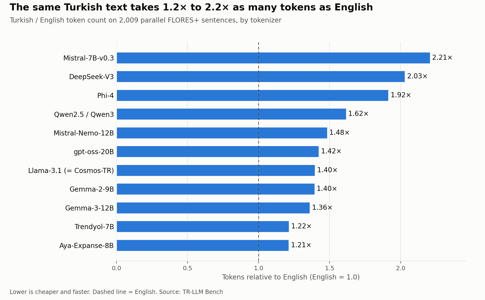
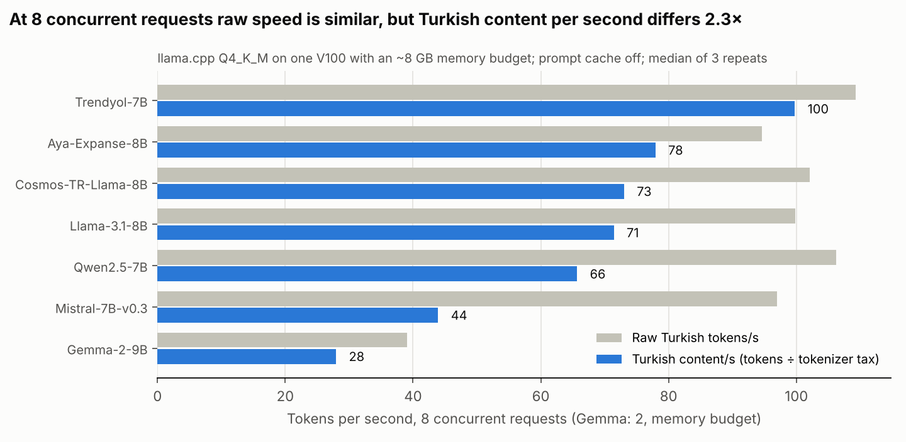
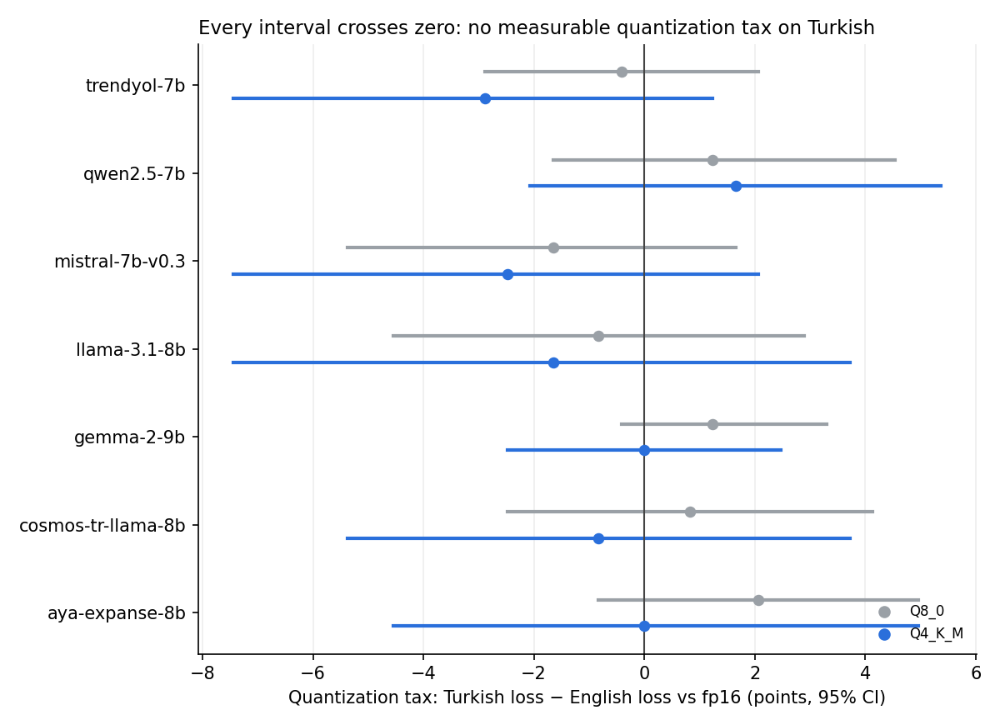
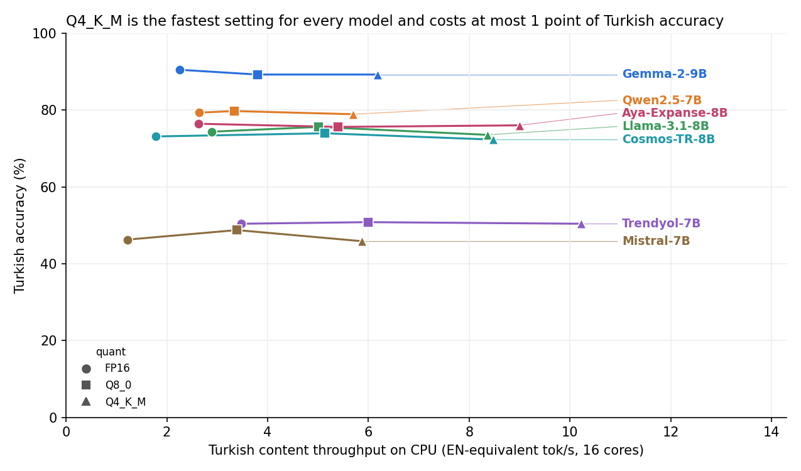

# TR-LLM Bench

[English](README.md) · **Türkçe**

Açık kaynak LLM'lerle Türkçe servis etmenin maliyeti ne, ve quantization Türkçenin kalitesinden
İngilizceye göre ne kadar götürüyor?

**[Leaderboard](https://huggingface.co/spaces/HaticeB/tr-llm-bench)** · **[Eval set](https://huggingface.co/datasets/HaticeB/tr-llm-bench-eval)**

Bütün ölçümler paralel TR/EN veriyle ve deterministik puanlamayla yapıldı (seed 2026, LLM hakem
kullanılmadı). Bu sayede Türkçe ve İngilizce sonuçlar birebir karşılaştırılabiliyor.

Bu sayfa İngilizce README'nin çevirisi; ikisi arasında bir fark görürseniz İngilizce sürüm geçerlidir.

## 1. Tokenizer tax

Aynı FLORES+ cümleleri her dilde farklı sayıda token'a bölünüyor.
**Tax = toplam Türkçe token / toplam İngilizce token.** Fertility (kelime başına token) kullanmıyoruz,
çünkü kelime uzunlukları dilden dile değişiyor.

| Tokenizer (aynı tokenizer'ı kullanan modeller) | TR | FI | HU | DE | FR |
|---|---|---|---|---|---|
| Kumru-2B (Türkçe odaklı) | 0,64 | 1,49 | 1,69 | 1,48 | 1,52 |
| Trendyol-7B | 1,10–1,22 ¹ | 1,95 | 1,94 | 1,56 | 1,58 |
| Aya-Expanse-8B | 1,21 | 1,93 | 2,08 | 1,32 | 1,33 |
| Gemma-3-12B | 1,36 | 1,66 | 1,67 | 1,32 | 1,40 |
| Gemma-2-9B | 1,40 | 1,61 | 1,66 | 1,25 | 1,35 |
| Llama-3.1-8B / Cosmos-TR-Llama-8B | 1,40 | 1,98 | 2,11 | 1,58 | 1,59 |
| gpt-oss-20b / Phi-4-mini | 1,42 | 1,56 | 1,79 | 1,31 | 1,36 |
| Mistral-Nemo-12B / Ministral-8B | 1,48 | 1,65 | 1,61 | 1,30 | 1,31 |
| Qwen2.5-7B / Qwen3-8B | 1,62 | 1,97 | 2,11 | 1,55 | 1,57 |
| Granite-3.3-8B | 1,72 | 1,87 | 1,91 | 1,61 | 1,62 |
| Phi-4 | 1,92 | 1,99 | 2,14 | 1,58 | 1,59 |
| DeepSeek-V3 | 2,03 | 1,87 | 1,98 | 1,51 | 1,54 |
| Mistral-7B-v0.3 | 2,21 | 2,01 | 2,00 | 1,58 | 1,59 |

Değerler aynı 2.009 cümlede İngilizceye göre token sayısı (İngilizce = 1,0). %95 bootstrap aralıkları
(cümleler yeniden örneklenerek, diller arasında eşleştirilmiş olarak) `results/tokenizer_langs.csv`
dosyasında, cümle başına token sayıları (yalnızca sayılar, metin yok) `results/tokenizer_counts.csv.gz`
dosyasında.

1,62'lik bir tax, aynı Türkçe içeriğin %62 daha fazla token'a mal olması demek: daha yüksek latency,
daha az kullanılabilir context ve daha düşük content throughput. Trendyol, vocabulary'sini Türkçe
token'larla genişleterek (32.768 → 44.312 token) tax'i 1,10'a indiriyor; bu, genel amaçlı modeller
arasındaki en düşük değer.

**Bu maliyet Türkçeye özgü değil.** 13 farklı tokenizer'ın 11'inde Türkçe, diğer iki eklemeli dil olan
Fince ve Macarcadan daha az token'a bölünüyor (aralıklar hiç çakışmıyor); istisnalar Mistral-7B-v0.3 ve
DeepSeek-V3. Almanca ve Fransızcayla karşılaştırınca tablo karışık. Bu da belirleyici olanın tek başına
morfoloji değil, tokenizer'ın eğitim verisi olduğuna işaret ediyor: Türkçe odaklı bir tokenizer (Kumru),
Türkçeyi İngilizceden bile *daha ucuz* hale getiriyor.

¹ *Tokenizer dosyaları aynı (repo Haziran 2024'ten beri değişmedi), kütüphaneler farklı:* transformers
4.57.3'teki fast tokenizer 1,10, SentencePiece (slow) tokenizer 1,12 veriyor; daha eski bir transformers
sürümüyle yapılan ilk ölçüm ise 1,22 vermişti. Eval prompt'larında, modeli 2. bölümde servis eden
llama.cpp'nin tokenizer'ı 1,10, sunucudaki transformers ise aynı metin için 1,16 veriyor; bu yüzden servis
sonuçlarında 1,10 kullanılıyor. Artık her tokenizer satırına repo commit'i, tokenizer sınıfı ve kütüphane
sürümleri de kaydediliyor. Diğer bütün tokenizer'lar ölçümü birebir tekrarladı.




## 2. Paylaşımlı bir V100'de servis performansı

Load testlerinde çıktı uzunluğu sabit (`min_tokens` + `ignore_eos`, 256 token), TTFT ise streaming ile
ölçülüyor. Ham tok/s değerinin yanında **content throughput = tok/s ÷ tax** de veriliyor, çünkü bir
Türkçe token, bir İngilizce token'dan daha az içerik taşıyor.

GPU, canlıdaki bir servisle paylaşılıyordu. Benchmark tek bir V100'de, yaklaşık 8 GB'lık bir bütçeyle
ve diğer GPU'lar ya da servis etkilenirse ölçümü durduran bir guard altında çalıştı. O GPU'daki toplam
bellek kullanımı, servis dahil, en fazla 12,9 GB'a çıktı (planlanan üst sınır 15,5 GB). 138 koşu, 0 hata.

**Prompt cache uyarısı.** Her koşu aynı prompt'ları tekrar gönderiyor ve iki engine de prompt'ları
varsayılan olarak cache'liyor (vLLM'de prefix cache, llama-server'da istek başına `cache_prompt`). Bu
yüzden ilk tekrardan sonraki TTFT büyük ölçüde bir cache hit oluyor, llama.cpp'nin throughput'u da 4–8
eşzamanlı istekte %15–35 olduğundan yüksek çıkıyor. 2a, 2b (*Cold cache*) ve 2c bölümleri cache kapalıyken
ölçüldü. 2b'deki ilk tablo ve 2e'deki tarihsel vLLM koşusu ise cache açıkken ölçüldü: oradaki TTFT
değerleri, cache'siz ilk token süresinden düşük (llama.cpp'de 4–8 kat). 2d bölümü, prompt cache'i olmayan
`llama-bench` ile ölçüldü.

### 2a. Yedi model, llama.cpp, Q4_K_M

3 tekrarın medyanı, **prompt cache kapalı** (her istekte `cache_prompt: false`,
`configs/gpu_llamacpp_cold.yaml`, `results/gpu_llamacpp_cold.jsonl`); yani her istek prefill'in tamamını
ödüyor. Üç hız ölçüsü var, üçü de Türkçe çıktı için:

- **TR tok/s**: engine'in raporladığı haliyle saniyedeki ham token sayısı.
- **TR kelime/s (ölçülen)**: saniyede gerçekten üretilen kelime sayısı; kullanmadan önce ² notuna bakın.
- **TR content tok/s** = TR tok/s ÷ tokenizer tax: saniyede kaç İngilizce token'lık içerik üretildiği.
  Aşağıdaki karşılaştırmalarda bu değer kullanılıyor.

Maliyet hesabında **GPU saati 1 $** varsayıldı (kendi fiyatınıza göre doğrusal olarak ölçekleyin) ve GPU
tam yükte kabul edildi. Saniyedeki Türkçe kelime sayısı = token ÷ FLORES+'ta Türkçe kelime başına token.

| Model | c=1 TR tok/s | En yüksek c | TR tok/s | EN tok/s | TR kelime/s (ölçülen) ² | TR content tok/s | TTFT p50 TR (ms) | GPU 2 tepe (GB) | 1.000 TR kelime başına $ (1 $/saat) |
|---|---|---|---|---|---|---|---|---|---|
| Trendyol-7B | 35 | 8 | 109 | 110 | 50 | **100** | 3954 | 9,7 | 0,0047 |
| Aya-Expanse-8B | 31 | 8 | 95 | 97 | 43 | **78** | 3956 | 10,4 | 0,0054 |
| Cosmos-TR-Llama-8B | 33 | 8 | 102 | 107 | 46 | **73** | 4027 | 10,0 | 0,0058 |
| Llama-3.1-8B | 33 | 8 | 100 | 105 | 42 | **71** | 4324 | 12,4 | 0,0060 |
| Qwen2.5-7B | 34 | 8 | 106 | 114 | 39 | **66** | 3734 | 9,0 | 0,0066 |
| Mistral-7B-v0.3 | 34 | 8 | 97 | 112 | 29 | **44** | 4764 | 9,7 | 0,0107 |
| Gemma-2-9B | 24 | 2 | 39 | 40 | 3 | **28** | 1547 | 12,9 | 0,0152 |

² *Bu düzenekte ölçülen kelime/s bir içerik ölçüsü değil.* Her istek 256 çıktı token'ına zorlanıyor
(`min_tokens` + `ignore_eos`), yani model doğal cevabını bitirdikten sonra da üretmeye devam ediyor ve bu
kısımda ürettiği şey çoğu zaman kelime değil. Kaydedilen örnekler
(`python -m trbench.eval.queue_report --samples`) bunu doğruluyor: Gemma-2-9B cevabını verdikten sonra
256 token'ın kalanını satır sonlarıyla dolduruyor (43 tok/s'den 4 kelime/s), Trendyol-7B ise yazmaya devam
ediyor, bazen bir döngüye girerek. Modelleri karşılaştırırken ölçülen kelime/s'yi değil, content tok/s'yi
kullanın.



- **Engine aynı, GPU aynı, ham hızlar birbirine yakın (8 eşzamanlı istekte 95–109 tok/s); ama saniyedeki
  Türkçe içerik 44 ile 100 arasında değişiyor.** Bir GPU saatinin ne kadar Türkçe ürettiğini model boyutu
  değil, tokenizer belirliyor: Türkçe kelime başına Mistral-7B, Trendyol'un 2,3 katına mal oluyor.
- **Prompt cache bu farkın bir kısmını gizliyordu.** llama-server'ın varsayılan cache'iyle yapılan önceki
  ölçüm 121–130 tok/s ve 57–119 content tok/s vermişti. Cache kapatılınca Türkçe throughput %8–23 düşüyor;
  en büyük düşüş, tokenizer tax'i en yüksek model olan Mistral-7B'de (127 → 97 tok/s). Yani modeller
  arasındaki fark daha da açılıyor.
- Gemma-2-9B 2 eşzamanlı istekle çalışıyor: KV cache'i (token başına ~344 KB) 8 istek için bütçeye sığmıyor.
- Trendyol'un tax'i 1,10 alındı: bu hem fast tokenizer ile FLORES+ değeri, hem de modeli servis eden
  llama.cpp'nin kendi tokenizer'ının eval prompt'larında verdiği değer (1. bölümdeki ¹ notuna bakın).

### 2b. Engine karşılaştırması: vLLM ve llama.cpp (Mistral-7B, 4-bit)

Aynı model, aynı GPU, aynı ~8 GB bütçe; vLLM eager mode'da (CUDA graphs bütçeden fazla bellek istiyor):

- **llama.cpp** `b12470`, Q4_K_M.
- **vLLM, V100 build'i, AWQ-int4.** Upstream vLLM, V100'de AWQ'yu kabul etmiyor (compute capability 7.5
  istiyor, V100 ise 7.0). Bu yüzden bu sütun V100 için yamalanmış bir vLLM build'inden geliyor ve
  `pip install vllm` ile tekrarlanamaz.
- **vLLM 0.18.1 (upstream, PyPI), GPTQ-int4** (`RedHatAI/Mistral-7B-Instruct-v0.3-GPTQ-4bit`,
  `--quantization gptq`). V100'ü hâlâ destekleyen son upstream seri; bu sütunu herkes tekrarlayabilir
  (`configs/gpu_vllm_upstream_gptq.yaml`).

| Concurrency | Dil | llama.cpp tok/s | vLLM AWQ (V100 build'i) tok/s | vLLM 0.18.1 GPTQ tok/s | TTFT p50 llama.cpp / AWQ / GPTQ (ms) |
|---|---|---|---|---|---|
| 1 | EN | 36 | 26 | 30 | 89 / 100 / 78 |
| 1 | TR | 35 | 28 | 29 | 117 / 98 / 85 |
| 4 | EN | 85 | 100 | 114 | 218 / 170 / 220 |
| 4 | TR | 76 | 101 | 108 | 328 / 189 / 235 |
| 8 | EN | 128 | 199 | 137 | 560 / 248 / 298 |
| 8 | TR | 127 | 152 | 107 | 683 / **2482** / **2157** |

- **Cache'ler açıkken tek kullanıcıda llama.cpp, 4 istekte vLLM önde** (iki vLLM ile de Türkçede %33–41
  fazla): CUDA graphs olmadan vLLM her adımda bir ek yük ödüyor, batching bu yükü ancak daha fazla
  istekte telafi ediyor.
- **Dar bütçede 8 istekte Türkçe, vLLM'in avantajını kaybediyor; bu upstream vLLM için de geçerli.**
  Upstream GPTQ'da Türkçe throughput (107 tok/s) llama.cpp'nin bile altına iniyor (127).
- Bu tablodaki vLLM TTFT değerleri prefix cache açıkken ölçüldü (yukarıdaki uyarıya bakın): 8 istekte
  İngilizcedeki 0,25–0,3 sn'lik ilk token bir cache hit, Türkçede ise 2,2–2,5 sn'de kalıyor (muhtemelen
  daha uzun Türkçe prompt'ların hepsi küçük cache'te tutulamadığı için). Bu yüzden ikisi karşılaştırılamaz.
  İki dil için cache'siz prefill değerleri 2c bölümünde.
- İki vLLM sütunu hem build hem 4-bit format açısından farklı. Aralarındaki fark (örneğin 8 istekte
  İngilizcede 199'a karşı 137 tok/s) bu ikisinden yalnızca birine bağlanamaz.
- Yalnızca Mistral karşılaştırılabildi: Llama-3.1 ve Qwen2.5 AWQ bütçe içinde başlamadı. 128k–152k'lık
  vocabulary'leri büyük embedding ve output katmanlarını 16-bit tutuyor; yükleme 6,5 GiB tuttu ve KV
  cache'e yer kalmadı (vLLM kullanılabilir bellek olarak −1,01 GiB bildirdi).

#### Cold cache: prompt cache kapalıyken Mistral-7B

Yukarıdaki tablo, iki engine'in de prompt cache'i açıkken ölçüldü. Cache kapatılarak yeniden ölçüldü
(llama.cpp: her istekte `cache_prompt: false`, `configs/gpu_llamacpp_nocache.yaml`; vLLM 0.18.1 GPTQ:
`--no-enable-prefix-caching`, `configs/gpu_6d_mnbt2048.yaml`). Her hücre 5 tekrar, doğal eval prompt'ları:

| Concurrency | Dil | llama.cpp tok/s | vLLM 0.18.1 GPTQ tok/s | TTFT p50 llama.cpp / vLLM (ms) |
|---|---|---|---|---|
| 1 | EN | 35 | – | 521 / – |
| 1 | TR | 34 | – | 708 / – |
| 4 | EN | 74 | 105 | 1999 / 923 |
| 4 | TR | 48 | 94 | 2988 / 1599 |
| 8 | EN | 113 | 126 | 3550 / 1677 |
| 8 | TR | 97 | 108 | 4537 / 2340 |

- **Cache kapalıyken vLLM, 4 ve 8 istekte iki dilde de önde.** 4 istekte Türkçenin 2 kat uzun prompt'ları
  llama.cpp'nin throughput'undan %35 götürüyor (74'e karşı 48 tok/s), vLLM'inkinden %10 (105'e karşı 94);
  8 istekte ikisi de %14 kaybediyor.
- **Cache'siz ilk token, yukarıdaki cache'li değerlerden 4–8 kat uzun sürüyor;** llama.cpp'de Türkçe,
  İngilizceden 1,3–1,5 kat uzun bekliyor. Bu, vLLM'deki sonuçla uyumlu (2c bölümü).
- vLLM, cache kapalıyken 1 istekte ölçülmedi. Aynı gün cache açık yapılan llama.cpp koşusu yukarıdaki
  deseni tekrarladı (ilk tekrardan sonra TTFT 87–711 ms), ancak 4 istekteki Türkçe throughput önceki
  koşudaki gibi 76 değil, 55 tok/s çıktı; bu farkın nedeni açıklanamadı.

### 2c. Türkçe neden daha uzun bekliyor: dil değil, token sayısı

Upstream vLLM 0.18.1, Mistral-7B GPTQ, `gpu_memory_utilization` 0.20, closed-loop yük, warm-up sonrası
her hücre 5 tekrar, koşu başına 24 istek. **Prefix cache kapalı** (`--no-enable-prefix-caching`), yani her
tekrar prefill'in tamamını ödüyor. Kuyruk, vLLM'in `/metrics` endpoint'inden 0,25 sn'de bir okunuyor
(`configs/gpu_6d_mnbt*.yaml`, `python -m trbench.eval.queue_report --file results/gpu_6d_mnbt.jsonl`).
*Prompt token'ları*: doğal eval prompt'ları ya da iki dilde de modelin kendi tokenizer'ıyla tam 300 token'a
kesilmiş prompt'lar.

| Prompt token'ları | Concurrency | EN TTFT p50 (ms) | TR TTFT p50 (ms) | TR / EN | Ortalama prompt token'ı EN / TR |
|---|---|---|---|---|---|
| doğal | 4 | 923 | 1599 | 1,73× | 200 / 399 |
| doğal | 8 | 1677 | 2340 | 1,40× | 197 / 393 |
| 300 | 4 | 1360 | 1361 | 1,00× | 304 / 304 |
| 300 | 8 | 2341 | 2270 | 0,97× | 304 / 304 |

- **Prompt uzunlukları eşitlenince dil farkı ortadan kalkıyor.** Doğal prompt'larla Türkçe 1,4–1,7 kat
  uzun bekliyor, çünkü Türkçe prompt'lar 2 kat fazla token tutuyor (tokenizer tax). İkisi de 300 token'a
  kesilince iki dil aynı süre bekliyor. 4 istekte hücre başına beş tekrar birbirinden en fazla ±%4 sapıyor.
- **Sebep istek kuyruğu değil.** vLLM hiçbir koşuda 2'den fazla bekleyen istek ve hiç preemption bildirmedi.
- **Sebep adım başına prompt bütçesi de değil.** `--max-num-batched-tokens` 2048'den 4096'ya çıkarılınca
  8 istekte Türkçe bekleme kısalmadı (3059 ms, daha yavaş); 1024'e indirilince İngilizce bekleme uzamadı
  (1309 ms). Bu README'nin önceki bir sürümü sebep olarak bu bütçeyi öne sürmüştü; bu koşu o ihtimali eledi.
- **Prefix cache maliyeti gizliyor.** Cache açıkken (vLLM'in varsayılanı) ve aynı prompt'lar tekrarlanınca,
  4 istekte TTFT ilk tekrardan sonra iki dilde de ~0,21 sn'ye düşüyor (ilk tekrar: EN 0,84 sn, TR 1,40 sn).
  Gerçek trafikte prompt'ların tamamı nadiren tekrarlanır; bu yüzden geçerli olan yukarıdaki cache'siz
  değerler. Ortak bir system prompt kullanan bir sistem ikisinin arasında bir yerde kalır.
- `/metrics`'i yoklamak sonucu değiştirmiyor (EN, 4 istek: kapalı 920 ms, açık 923 ms).
- Bu sayılar V100'de eager mode'da ~5–6 GB vLLM belleği için geçerli; başka bir donanımda mutlak değerler
  farklı olur, ama prompt token sayısıyla orantılı olma durumu genellenebilir.

### 2d. GPU'da context uzunluğu (llama-bench)

Her hücre 3 tekrarın medyanı. GPU paylaşımlı olduğu için tek tek tekrarlar ara sıra düştü
(örneğin 37, 37, 21 tok/s); medyan bu sapmaları dışarıda bırakıyor.

| Model | Decode tok/s, boş context | 4.096 token context ile | Değişim | Prefill tok/s (4.096 token'lık prompt) |
|---|---|---|---|---|
| Aya-Expanse-8B | 33,1 | 30,9 | −%7 | 702 |
| Llama-3.1-8B | 35,9 | 33,2 | −%8 | 704 |
| Cosmos-TR-Llama-8B | 35,9 | 33,1 | −%8 | 703 |
| Mistral-7B-v0.3 | 38,3 | 35,2 | −%8 | 705 |
| Trendyol-7B | 37,8 | 34,8 | −%8 | 706 |
| Qwen2.5-7B | 37,2 | 33,6 | −%10 | 752 |
| Gemma-2-9B | 27,1 | 23,3 | −%14 | 436 |

- Context'te zaten 4.096 token varken decode %7–10 daha yavaş (Gemma'da %14). Türkçe aynı metin için
  1,1–2,2 kat fazla token gerektirdiğinden bu noktaya daha erken ulaşıyor.

### 2d+. Context window tax (aynı içerik, İngilizce ve Türkçe uzunlukta)

Aynı metin Türkçede tax katı kadar fazla token tutuyor. Bu yüzden her modeli İngilizce uzunlukta (E) ve
Türkçe uzunlukta (E × tax) ölçtük (llama-bench, Q4_K_M, GPU, 3 tekrarın medyanı). Gemma-2-9B yalnızca
E = 1.024'te ölçüldü: daha uzun Türkçe context'ler 7,5 GB'lık bütçeye sığmıyor.
Veri: `results/gpu_context.jsonl`, tablo: `python -m trbench.eval.context_tax`.

4.096 İngilizce token'lık içerik için:

| Model | Tax | TR token | KV cache EN / TR (MB) | 8.192 token'lık context window'a sığan içerik (EN token) | Decode tok/s EN / TR | Değişim | Prefill EN / TR (sn) |
|---|---|---|---|---|---|---|---|
| Trendyol-7B | 1,10 | 4.489 | 512 / 561 | 7.475 | 34,9 / 34,8 | −%0 | 5,8 / 6,5 |
| Aya-Expanse-8B | 1,21 | 4.973 | 512 / 622 | 6.747 | 31,0 / 30,7 | −%1 | 5,8 / 7,3 |
| Cosmos-TR-Llama-8B | 1,40 | 5.726 | 512 / 716 | 5.860 | 33,3 / 32,7 | −%2 | 5,8 / 8,7 |
| Llama-3.1-8B | 1,40 | 5.726 | 512 / 716 | 5.860 | 33,3 / 32,7 | −%2 | 5,8 / 8,7 |
| Qwen2.5-7B | 1,62 | 6.625 | 224 / 362 | 5.065 | 33,6 / 31,5 | −%6 | 5,4 / 9,3 |
| Mistral-7B-v0.3 | 2,21 | 9.044 | 512 / 1.130 | 3.710 | 35,5 / 33,0 | −%7 | 5,8 / 14,3 |

1.024 İngilizce token'da desen aynı, etkiler daha küçük (decode −%0 ile −%3 arası; Gemma-2-9B:
26,4 / 25,9 tok/s, −%2, prefill 1,9 / 2,8 sn).

- **En büyük maliyet context window'da.** 8.192 token'lık bir window, Mistral-7B ile ancak 3.710 İngilizce
  token'a denk Türkçe içerik alabiliyor; Trendyol-7B ile bu sayı 7.475. Uzun doküman ve RAG prompt'ları
  sınıra tax katı kadar erken ulaşıyor.
- **Prefill süresi en az tax oranında artıyor.** Mistral-7B aynı içeriği Türkçede 2,5 kat yavaş okuyor
  (14,3'e karşı 5,8 sn). Bu, 2,21'lik token oranından biraz fazla, çünkü attention maliyeti uzunlukla
  birlikte büyüyor. Bu fark doğrudan TTFT'ye ekleniyor.
- **KV cache belleği tax oranında büyüyor** (Mistral: 4K token'lık istek başına 0,5 GB yerine 1,1 GB).
  Bu, aynı GPU'da daha az eşzamanlı istek demek.
- **Token başına decode hızı neredeyse değişmiyor** (%0–7). Türkçenin decode maliyeti büyük ölçüde daha
  fazla token gerektirmesinden geliyor (2a bölümü); token'ların tek tek yavaşlamasından değil.
- Cosmos-TR-Llama-8B ve Llama-3.1-8B birebir aynı sonuçları veriyor: mimari, tokenizer ve dosya boyutu
  aynı olduğu için yapılan iş de aynı.

### 2e. Paylaşımsız bir GPU'da yapılan önceki koşu (tarihsel)

Qwen2.5-7B-Instruct, vLLM, tek bir V100 32 GB, istek başına 256 çıktı token'ı, 3 tekrarın medyanı.
*Kaynak:* 16 Kasım 2026'da `configs/phase3.yaml`'ın önceki bir sürümüyle ölçüldü (GPU memory utilization
0.80, CUDA graphs açık). Bu ayar, paylaşımlı sunucudaki bütçenin izin verdiğinden fazla bellek kullandığı
için config kullanımdan kaldırıldı. Bu sayılar güncel config ile tekrarlanamaz ve tarihsel bir sonuç olarak
tutuluyor. Content tok/s = TR tok/s ÷ 1,62.

| Quantization | Concurrency | EN tok/s | TR tok/s | TR content tok/s | TTFT p50 EN / TR (ms) |
|---|---|---|---|---|---|
| fp16 | 1 | 15,5 | 15,6 | 9,6 | 84 / 84 |
| fp16 | 4 | 61,0 | 60,6 | 37,4 | 217 / 196 |
| fp16 | 16 | 185,5 | 185,5 | 114,5 | 412 / 404 |
| fp16 | 32 | 273,8 | 265,0 | 163,6 | 540 / 602 |
| AWQ-int4 | 1 | 32,6 | 31,6 | 19,5 | 57 / 60 |
| AWQ-int4 | 4 | 124,6 | 122,7 | 75,7 | 117 / 125 |
| AWQ-int4 | 16 | 352,4 | 315,5 | 194,7 | 261 / 252 |
| AWQ-int4 | 32 | 449,9 | 431,0 | 266,0 | 529 / 554 |

- **Engine dilden bağımsız, tokenizer değil.** Ham tok/s Türkçe ve İngilizce için neredeyse aynı, ama
  Türkçe kullanıcılar saniyede ~%38 daha az içerik alıyor.
- **AWQ-int4, V100'de her concurrency seviyesinde fp16'ya göre throughput'u kabaca ikiye katlıyor**
  (tek akışlı decode memory-bound olduğu için 4 kat küçük ağırlıklar doğrudan kazanca dönüşüyor).
- Qwen2.5-14B AWQ-int4 (yalnızca Türkçe, kısmi koşu): c=1'de 17,7 tok/s, c=32'de 203 tok/s.

Bulgu: Attention bias içeren modellerde (örneğin Qwen) GPTQ-int8, V100'de (SM70) çalışmıyor, çünkü Marlin
kernel'i bias'ı desteklemiyor.

## 3. Quantization'ın Türkçe kaliteye maliyeti (llama.cpp, CPU)

550 madde: paralel TR/EN okuma (Belebele), bilgi (Global-MMLU'nun kültürden bağımsız alt kümesi),
matematik (GSM8K / GSM8K-TR), instruction following, JSON extraction ve yalnızca Türkçe bir morfoloji seti.

**Quantization tax = (Türkçedeki doğruluk kaybı) − (İngilizcedeki doğruluk kaybı)**, fp16'ya göre,
%95 bootstrap güven aralıklarıyla.

Yedi instruct model; GGUF'lar orijinal ağırlıklardan üretildi (Qwen: resmi GGUF), llama.cpp `b12470`, CPU,
greedy decoding. fp16 doğruluğu (%, TR / EN), yanlış çevrilmiş 8 madde çıkarılmış olarak (aşağıya bakın):

| Model | Okuma | Bilgi | Matematik | Instruction | JSON | Morfoloji (TR) |
|---|---|---|---|---|---|---|
| Gemma-2-9B | 87 / 95 | 63 / 66 | 97 / 97 | 98 / 85 | 100 / 100 | 88 |
| Qwen2.5-7B | 85 / 95 | 45 / 68 | 79 / 95 | 78 / 75 | 100 / 100 | 64 |
| Aya-Expanse-8B | 84 / 96 | 53 / 63 | 69 / 85 | 70 / 83 | 100 / 100 | 90 |
| Cosmos-TR-Llama-8B | 75 / 96 | 50 / 55 | 69 / 77 | 67 / 77 | 100 / 100 | 88 |
| Llama-3.1-8B | 67 / 91 | 58 / 61 | 79 / 90 | 67 / 97 | 100 / 100 | 66 |
| Trendyol-7B v1.8 | 82 / 78 | 50 / 58 | 36 / 36 | 32 / 18 | 50 / 50 | 86 |
| Mistral-7B-v0.3 | 35 / 87 | 42 / 53 | 23 / 59 | 32 / 60 | 98 / 100 | 64 |



242 eşleştirilmiş maddede quantization tax (yüzde puan; pozitif = Türkçe daha çok kaybediyor;
%95 bootstrap güven aralığı):

| Model | Q8_0 | Q4_K_M |
|---|---|---|
| Gemma-2-9B | +1,2 [−0,4, +3,3] | −0,0 [−2,5, +2,5] |
| Qwen2.5-7B | +1,2 [−1,7, +4,5] | +1,7 [−2,1, +5,4] |
| Aya-Expanse-8B | +2,1 [−0,8, +5,0] | +0,0 [−4,5, +5,0] |
| Cosmos-TR-Llama-8B | +0,8 [−2,5, +4,1] | −0,8 [−5,4, +3,7] |
| Llama-3.1-8B | −0,8 [−4,5, +2,9] | −1,7 [−7,4, +3,7] |
| Trendyol-7B v1.8 | −0,4 [−2,9, +2,1] | −2,9 [−7,4, +1,2] |
| Mistral-7B-v0.3 | −1,7 [−5,4, +1,7] | −2,5 [−7,4, +2,1] |

- **Yedi modelin hiçbirinde ölçülebilir bir quantization tax yok.** 14 aralığın hepsi sıfırı içeriyor:
  Q4_K_M'e kadar Türkçe, İngilizceden daha fazla bozulmuyor.
- **Diller arasındaki farkı base model belirliyor ve bu fark modelden modele çok değişiyor.** Gemma-2-9B
  matematikte iki dilde eşit, bilgide neredeyse eşit; Qwen2.5-7B bilgide 23 puan geride; Llama-3.1-8B
  okumada 24, Türkçe instruction following'de 30 puan geride. Tokenizer tax'i en kötü olan model
  Mistral-7B (2,21 kat), Türkçede de genel olarak en zayıf model.
- **Morfolojide çok dilli ve Türkçeye fine-tune edilmiş modeller önde:** Aya 90, Gemma 88, Cosmos 88,
  Trendyol 86; Qwen, Llama ve Mistral'de ise 64–66.
- **Türkçe fine-tune Türkçeye yarıyor, ama yapılandırılmış çıktıya sızabiliyor.** Trendyol-7B v1.8,
  okumada Türkçede İngilizceden daha iyi olan tek model (Türkçe 82, İngilizce 78), ama ürettiği JSON'ların yarısı
  geçersiz: prompt İngilizce olsa bile Türkçe ondalık virgülü (`"birim_fiyat": 3,75`) ve Türkçe key'ler
  kullanıyor. Cosmos (Türkçe üzerine fine-tune edilmiş Llama-3) ise bu yan etki olmadan okuma ve
  morfolojide Llama-3.1-8B'ye göre kazanç sağlıyor.
- **Bu süreçte karşılaşılan pratik tuzaklar:**
  - Trendyol-7B v1.8 (Mistral tabanlı) bir chat template ile gelmiyor. llama.cpp sessizce ChatML'e
    geçti ve ilk koşu anlamsız çıktı. Yukarıdaki sayılar, modelin `[INST]` formatıyla
    (`configs/chat_templates/mistral_inst.jinja`) yapılan yeniden koşudan geliyor. Dönüştürdüğünüz her
    modelin template'ini kontrol edin; `scripts/queue_models.sh` artık template'i olmayan bir modeli
    ölçmeyi reddediyor.
  - Aya, turn sonu token'ını (`<|END_OF_TURN_TOKEN|>`) metin olarak yazdı ve çoktan seçmeli soruları
    yalnızca bir harf ve ardından bir açıklamayla cevapladı. Cevaplar turn token'ında kesildi (greedy
    decoding'de doğru bir durmayla birebir aynı; `trbench.eval.rescore`) ve puanlayıcı, ardından satır sonu
    gelen tek bir harfi okuyacak şekilde düzeltildi. Bütün modeller aynı kurallarla yeniden puanlandı;
    yalnızca Aya'nın ve Gemma'nın 4 maddesinin sonucu değişti.

### GPU'da on dört model (Q4_K_M)

Aynı 550 madde, paylaşımlı V100'de llama.cpp (`scripts/gpu_quality.sh`), greedy decoding. Yedi yeni model
eklendi; CPU'daki yedi model de aynı GGUF dosyalarıyla GPU'da yeniden koşuldu. Eşleştirilmiş maddeler
8 çeviri hatası çıkarılmış olarak; morfoloji yalnızca Türkçe. 242 eşleştirilmiş maddeyle tek bir doğruluk
değerinin %95 aralığı yaklaşık ±5 puan; yani tabloda yan yana duran modeller birbirinden ayırt edilemiyor.

| Model | TR | EN | TR − EN | Morfoloji | CPU ile aynı sonuç |
|---|---|---|---|---|---|
| Gemma-2-9B | %90 | %89 | +1 | %88 | %99 |
| Qwen3-8B | %81 | %92 | −11 | %92 | – |
| Qwen2.5-7B | %79 | %88 | −10 | %60 | %98 |
| Qwen3-4B | %77 | %91 | −14 | %70 | – |
| Gemma-3-4B | %76 | %87 | −11 | %88 | – |
| Aya-Expanse-8B | %76 | %86 | −10 | %92 | %97 |
| Llama-3.1-8B | %74 | %85 | −11 | %44 | %95 |
| Phi-4-mini | %70 | %88 | −19 | %64 | – |
| Cosmos-TR-Llama-8B | %70 | %82 | −12 | %84 | %96 |
| Trendyol-7B | %51 | %45 | +6 | %84 | %98 |
| Llama-3.2-3B | %50 | %76 | −26 | %42 | – |
| Granite-3.3-8B | %50 | %87 | −37 | %46 | – |
| Ministral-8B | %48 | %81 | −34 | %72 | – |
| Mistral-7B-v0.3 | %48 | %71 | −23 | %58 | %94 |

- **GPU ve CPU aynı sonucu veriyor.** İkisinde de ölçülen yedi modelde maddelerin %94–99'u aynı
  doğru/yanlış sonucunu alıyor ve doğruluk en fazla 2 puan oynuyor: kalite sonuçları backend'e bağlı değil.
- **Türkçede belirleyici olan boyut değil.** Gemma-3-4B ve Qwen3-4B, 8B modellerle (Llama-3.1, Cosmos)
  aynı seviyede ya da onlardan iyi; Granite-3.3-8B ve Ministral-8B ise İngilizceden Türkçeye geçince 34–37
  puan kaybediyor.
- **İngilizce doğruluk bu farkı gizliyor.** Granite-3.3-8B İngilizcede %87, Türkçede %50; İngilizce bir
  benchmark onu Gemma-3-4B ile aynı sıraya koyardı.
- İki koşu düzeltme gerektirdi, ikisi de kodda belgelendi: Aya-Expanse turn sonu token'ını metin olarak
  yazdı (CPU'daki gibi kesildi ve yeniden puanlandı); Qwen3-4B ise `--reasoning-budget 0`'a rağmen düz
  metin olarak reasoning yapmaya devam etti, bu yüzden `enable_thinking=false` ile yeniden koşuldu
  (`configs/gpu_quality_rerun.txt`). Ham satırlar: `results/gpu_quality.jsonl`;
  `python -m trbench.eval.gpu_quality_report` tabloyu yeniden üretiyor.

### KV cache quantization (GPU)

Aynı Q4_K_M ağırlıklar, aynı 550 madde, flash attention açık llama.cpp; değişen tek şey KV cache tipi
(`--cache-type-k/v` f16, q8_0, q4_0; `configs/gpu_kvcache.txt`, `configs/gpu_kvcache2.txt`). Bellek, her
koşu sırasında benchmark GPU'sundaki tepe değer; tax, 242 eşleştirilmiş maddede f16 cache'e göre ölçüldü,
%95 bootstrap güven aralığıyla.

| Model | KV cache | GPU belleği (MiB) | TR kaybı | EN kaybı | KV tax [%95 GA] |
|---|---|---|---|---|---|
| Gemma-2-9B | f16 | 12320 | – | – | – |
| | q8_0 | 11076 | +0,4 | +0,0 | +0,4 [−0,8, +2,1] |
| | q4_0 | 10404 | +0,0 | −1,7 | +1,7 [−0,8, +4,1] |
| Qwen3-8B | f16 | 9736 | – | – | – |
| | q8_0 | 9204 | −0,4 | +0,0 | −0,4 [−1,7, +0,8] |
| | q4_0 | 8916 | +0,4 | −0,8 | +1,2 [−2,9, +5,4] |
| Llama-3.1-8B | f16 | 9568 | – | – | – |
| | q8_0 | 9096 | +0,4 | +2,5 | −2,1 [−5,4, +0,8] |
| | q4_0 | 8840 | +5,4 | −0,4 | +5,8 [+0,4, +11,2] |
| Cosmos-TR-Llama-8B | f16 | 9568 | – | – | – |
| | q4_0 | 8840 | −1,7 | +1,2 | −2,9 [−7,4, +1,2] |
| Llama-3.2-3B | f16 | 6908 | – | – | – |
| | q4_0 | 6272 | +0,0 | −3,3 | +3,3 [−3,7, +10,7] |

- **q8_0 cache bedava:** 0,5–1,2 GB daha az bellek, iki dilde de ölçülebilir bir değişiklik yok.
- **q4_0 cache 0,6–1,9 GB kazandırıyor ve tutarlı bir Türkçeye özgü kayıp göstermiyor.** Tek istisna
  Llama-3.1-8B'ydi (Türkçe −5,4 puan, aralık sıfırın hemen üstünde); bu yüzden ölçüm aynı aileden iki modelde
  tekrarlandı. İkisinde de bu etki görülmüyor: Cosmos-TR-Llama-8B (aynı mimari, Türkçe fine-tune) ters yönde
  hareket ediyor, Llama-3.2-3B ise Türkçede hiç kaybetmiyor. Sekiz karşılaştırmada bir aralığın sıfırı
  dışarıda bırakması, yalnızca şans eseri yaklaşık üç seferden birinde olur; Llama-3.1-8B sonucunu bir aile
  etkisi olarak değil, gürültü olarak okumak en doğrusu.
- Q4_K_M'e kadar ağırlık quantization'ında olduğu gibi (3. bölüm), 4-bit KV cache de hiçbir modelde
  Türkçeye İngilizceden kalıcı olarak daha pahalıya gelmedi. `python -m trbench.eval.kv_report` tabloyu
  yeniden üretiyor.

### Farkın ne kadarı benchmark'tan kaynaklanıyor?

fp16'nın Türkçede yanlış, İngilizcede doğru cevapladığı 38 maddenin hepsi tek tek incelendi:
**30'u gerçek model hatası, 8'i** Türkçe maddenin anlamını değiştiren **çeviri hatası**, 0'ı puanlama
hatası. Anlamı değiştiren hatalardan örnekler:

- Belebele-TR: "doğru olmayan" bir seçenek çeviride olumsuzluğunu kaybetmiş ve doğru hale gelmiş;
  "rotation" metinde "yörünge", seçeneklerde ise "dönüş" olarak çevrilmiş; "airline" seçeneklerde
  "havalimanı" olmuş.
- Global-MMLU-TR: "EXCEPT" atlanmış ve soru tersine dönmüş; "H2O(s)" (katı) "H2O(lar)" olmuş (Türkçe
  çoğul eki).
- GSM8K-TR: "her ayakla dakikada 200 vuruş" ifadesi belirsizleşmiş ("iki ayakla").

Bu 8 madde çıkarıldıktan sonra fp16'da Türkçe–İngilizce farkı:

| Kategori | Ham fark | Düzeltilmiş fark |
|---|---|---|
| Okuma | 16,7 puan | 9,0 puan |
| Bilgi | 27,5 puan | 23,7 puan |
| Matematik | 17,5 puan | 15,4 puan |

**Okumadaki farkın yaklaşık yarısı modelden değil, Belebele-TR'nin çeviri kalitesinden geliyor.** Bilgi ve
matematikteki farklar büyük ölçüde gerçek. Başka birkaç maddede de cevabı değiştirmeyen terim hataları var
(örneğin "24 hours" → "24 saniye", "discount rate" → "reeskont oranı" yerine "indirim oranı").

### Public ve özgün maddeler

Belebele, Global-MMLU ve GSM8K public veri setleri ve eğitim verisinde yer almış olabilirler; instruction ve
JSON maddeleri ise bu repoda üretildi ve başka hiçbir yerde yayımlanmadı. GPU koşusunda (Q4_K_M) TR−EN
doğruluk farkı, puan olarak, %95 paired-bootstrap aralıklarıyla (`python -m trbench.eval.breakdown`
kategori bazında aralıkları da veriyor):

| Model | Public: TR − EN | Özgün: TR − EN |
|---|---|---|
| Gemma-2-9B | −6 [−12, −1] | +9 [+4, +15] |
| Qwen3-8B | −14 [−22, −5] | −7 [−13, −3] |
| Qwen2.5-7B | −17 [−26, −10] | +0 [−5, +5] |
| Qwen3-4B | −13 [−20, −5] | −15 [−22, −9] |
| Aya-Expanse-8B | −11 [−20, −3] | −9 [−15, −3] |
| Llama-3.1-8B | −17 [−26, −8] | −4 [−13, +5] |
| Gemma-3-4B | −19 [−28, −10] | −1 [−3, +0] |
| Cosmos-TR-Llama-8B | −16 [−26, −6] | −7 [−14, −2] |
| Phi-4-mini | −20 [−29, −11] | −17 [−25, −10] |
| Trendyol-7B | +2 [−6, +10] | +10 [+5, +17] |
| Llama-3.2-3B | −17 [−26, −8] | −38 [−51, −25] |
| Ministral-8B | −31 [−42, −20] | −37 [−47, −27] |
| Granite-3.3-8B | −43 [−52, −34] | −30 [−39, −22] |
| Mistral-7B-v0.3 | −33 [−43, −23] | −11 [−18, −4] |

- **Türkçedeki fark yalnızca benchmark kaynaklı bir artefakt değil:** 14 modelin 9'u, hiçbir modelin daha
  önce göremeyeceği maddelerde de Türkçede geride kalıyor, 38 puana kadar.
- **Çoğu modelde fark public benchmark'larda daha büyük** (örneğin Qwen2.5-7B −17'ye karşı 0, Gemma-3-4B
  −19'a karşı −1). Bu, yukarıdaki çeviri hatalarıyla uyumlu; contamination da buna katkıda bulunuyor
  olabilir, ama bu veriyle ikisi birbirinden ayrılamıyor.
- Gemma-2-9B ve Trendyol-7B özgün maddelerde Türkçede İngilizceden daha iyi; bunu instruction following
  sağlıyor.

## 4. CPU'da kalite ve hız

Her GGUF üzerinde `llama-bench` (llama.cpp `b12470`, 16 çekirdek, 128 üretilen token, 3 tekrar); yanında
**Türkçe content throughput = tok/s ÷ tokenizer tax** ve eşleştirilmiş kategorilerde Türkçe doğruluk
(yanlış çevrilmiş maddeler çıkarılmış olarak).



Q4_K_M, her modelin en hızlı ayarı:

| Model (Q4_K_M) | CPU tok/s | TR content tok/s | TR doğruluk % |
|---|---|---|---|
| **Gemma-2-9B** | 8,7 | 6,2 | 89 |
| Qwen2.5-7B | 9,2 | 5,7 | 79 |
| **Aya-Expanse-8B** | 10,9 | 9,0 | 76 |
| Llama-3.1-8B | 11,7 | 8,4 | 74 |
| Cosmos-TR-Llama-8B | 11,9 | 8,5 | 72 |
| Trendyol-7B v1.8 | 12,5 | 11,3 | 50 |
| Mistral-7B-v0.3 | 13,0 | 5,9 | 46 |

- **Q4_K_M her modelde Türkçe doğruluktan en fazla 1 puan götürüyor** ve modelin en hızlı ayarı.
- **En doğru model Gemma-2-9B Q4_K_M; kalite–hız Pareto frontier'ındaki diğer noktalar Aya-Expanse-8B ve
  Trendyol-7B Q4_K_M** (%76 doğrulukla saniyede 9,0 Türkçe content token'ı, ve %50 doğrulukla saniyedeki en
  yüksek Türkçe içerik, 11,3).
- Ham hız, içerik hızı değil: Mistral-7B token cinsinden en hızlı model (13,0 tok/s), ama 2,21'lik tax'i
  yüzünden Türkçe içerikte en yavaşlar arasında (5,9).
- CPU'da fp16 hızı bellek yerleşimine bağlı: Cosmos ve Mistral fp16, iki kez tekrarlanan ölçümde 2,5 ve
  2,7 tok/s verdi; aynı mimarideki ikizleri (Llama, Trendyol) ise 4,1–4,2'de çalıştı ve dördü de Q8_0 ile
  Q4_K_M'de birbirinden en fazla 0,4 tok/s ayrılıyor. Modelleri Q8_0 ya da Q4_K_M'de karşılaştırın.

### Girdi uzunluğu

Q4_K_M, 16 çekirdek. 256 / 1.024 / 4.096 token'da prompt okuma hızı, ve boş context ile 4.096 token'lık
context'te üretim hızı:

| Model | Okuma 256 | Okuma 1k | Okuma 4k (tok/s) | Üretim, boş context | Üretim, 4k context |
|---|---|---|---|---|---|
| Qwen2.5-7B | 65,7 | 64,7 | 58,0 | 11,4 | 8,3 |
| Gemma-2-9B | 50,6 | 48,5 | 41,9 | 8,8 | 5,6 |
| Llama-3.1-8B | 62,3 | 60,2 | 52,6 | 11,9 | 8,3 |
| Trendyol-7B v1.8 | 62,1 | 59,7 | 53,6 | 12,9 | 7,9 |

Okuma 256'dan 4.096 token'a çıkınca %12–17 yavaşlıyor; context'te 4.096 token olunca üretim %27–39
yavaşlıyor. Aynı Türkçe metin 1,2–2,2 kat fazla token tuttuğundan, Türkçe bir sohbet bu yavaş bölgeye
İngilizce bir sohbetten daha erken giriyor: tokenizer tax uzun context'lerde bir kez daha ödeniyor.

## Özet

Açık kaynak 7–9B modelleri Türkçe kullanan biri için tablo şöyle: engine Türkçeyi token cinsinden İngilizce
kadar hızlı servis ediyor, ama bir GPU saatinin ne kadar Türkçe içerik ürettiğini tokenizer belirliyor (aynı
GPU'da, prompt cache kapalıyken 44 ile 100 content tok/s arası; Türkçe kelime başına 2,3 kat maliyet farkı).
8 GB bütçeli vLLM koşularımızda kullanıcının ilk token için ne kadar beklediğini de tokenizer belirliyor
(Mistral-7B, vLLM, cache kapalı: Türkçede 1,4–1,7 kat daha uzun; prompt'lar aynı token sayısına
getirilince eşit). Q4_K_M'e kadar quantization, yedi modelin hiçbirinde Türkçeye İngilizceden pahalıya
gelmiyor; q8_0 ya da q4_0 KV cache de öyle. On dört model arasında Türkçe doğruluk %48 ile %90 arasında
değişiyor ve model boyutunu izlemiyor (4B Gemma-3 ve Qwen3, birkaç 8B modeli geçiyor). Geriye kalan kalite
farkı base model'den geliyor (Gemma-2-9B'de küçük, Llama-3.1-8B ve Mistral-7B'de büyük) ve çeviri
benchmark'ları bu farkı kısmen büyütüyor.

Aynı tax context window'u da daraltıyor: 8.192 token'lık bir window, 3.710 ile 7.475 İngilizce token'a denk
Türkçe içerik alabiliyor ve aynı içeriğin prefill'i 2,5 kata kadar uzuyor; token başına decode ise
yalnızca %0–7 yavaşlıyor.

Hataları incelerken ortaya çıkan veri kalitesi notları: Belebele-TR'de çeviri kokan dil (translationese),
GSM8K-TR'de anlam hataları, Global-MMLU-TR'de terim hataları.

## Sınırlar

**Neler ölçüldü.** 4–9B açık kaynak modeller; 550 maddede kalite (8 çeviri hatası çıkarıldıktan sonra 242
TR/EN çifti, artı yalnızca Türkçe 50 morfoloji maddesi), greedy decoding, her konfigürasyon için tek koşu,
llama.cpp `b12470`. Servis, paylaşımlı tek bir V100'de (SM70) ~8 GB içinde: 4-bit modeller, en fazla 8
eşzamanlı istek (Gemma-2-9B: 2), closed-loop yük (bir istek bitince yenisi başlıyor), sabit 256 token'lık
çıktılar.

**Gözlenen (bu düzenek içinde geçerli):**
- 13 tokenizer'da tokenizer tax, ve aynı engine ve GPU'da saniyedeki Türkçe içeriği bu tax'in belirlediği.
- Q8_0 / Q4_K_M ağırlıklarda (7 model) ve q8_0 / q4_0 KV cache'te (5 model) ölçülebilir bir Türkçeye özgü
  kayıp yok. 242 çift kabaca ±4–6 puanlık aralıklar veriyor: daha küçük bir etki dışlanamaz.
- Çoğu modelde Türkçe, İngilizcenin hem çevrilmiş public benchmark'larda hem de bu proje için yazılmış özgün
  maddelerde gerisinde kalıyor (*Public ve özgün maddeler*), yani fark yalnızca contamination ya da
  çeviriden kaynaklanmıyor.
- vLLM'in prefix cache'i kapalıyken, 4–8 eşzamanlı istekte Mistral-7B'nin Türkçe TTFT'si İngilizcenin
  1,4–1,7 katı; iki prompt aynı token sayısına sahip olunca fark ortadan kalkıyor (2c bölümü). Ne istek
  kuyruğu, ne preemption, ne de adım başına prompt bütçesi bunu açıklıyor. llama.cpp de cache kapalıyken
  aynı yönü gösteriyor: 1–8 istekte 1,3–1,5 kat (2b bölümü, *Cold cache*).

**Yorum (olası, burada kanıtlanmadı):**
- Public benchmark'lardaki daha büyük farkın bir kısmı çeviri kalitesinden (8 doğrulanmış hata) ve muhtemelen
  contamination'dan geliyor; mevcut veriyle bu, madde zorluğundan ayrılamıyor.

**Bu veriden genellenemeyenler:**
- ~8 GB'lık bir V100 dışında mutlak hızlar, engine sıralaması ve TTFT değerleri.
- 2b'deki ilk tablonun TTFT ve llama.cpp throughput değerleri ile 2e'nin TTFT değerleri (prompt cache'ler
  açık, prompt'lar tekrarlanıyor). 2a, 2b *Cold cache* ve 2c cache'siz ölçüldü; 2d ise prompt cache'i
  olmayan `llama-bench` ile.
- 9B üstü modeller, fp16/Q8 servis, yüksek concurrency ve open-loop (gelme hızına dayalı) trafik.
- Tail latency. Her koşuda 16–32 istek var, yani p95/p99 bir koşunun maksimumuna yakın; README'de TTFT
  yalnızca p50 olarak veriliyor. Throughput için üç tekrar yeterli (2a'da tekrarlar arası fark tok/s'de
  ≤ %2,4).
- Kategori bazındaki farklar: kategori başına 40–60 maddeyle aralıklar geniş (bilgide ±18 puana kadar).

Diğer sınırlar: engine karşılaştırması yalnızca Mistral-7B'yi kapsıyor (bütçeye sığan tek 4-bit vLLM modeli),
vLLM eager mode'da; upstream vLLM, V100'de yalnızca 0.18.x'e kadar ve AWQ olmadan çalışıyor. GGUF dosyaları
orijinal ağırlıklardan llama.cpp `b12470` ile üretildi (Qwen ve yeni modeller: yayımlanmış GGUF dosyaları).

Eval set: [HaticeB/tr-llm-bench-eval](https://huggingface.co/datasets/HaticeB/tr-llm-bench-eval)
(özgün maddeler, üçüncü taraf maddelerin ID'leri, çeviri hataları listesi).

## Yeniden üretme

İki farklı amaç için iki kurulum:

- **Geliştirme** (testleri çalıştırmak, kodu okumak, analizi yayımlanmış sonuç dosyaları üzerinde yeniden
  koşmak): `pip install -e ".[dev,tok]"`. `pyproject.toml` yalnızca alt sınır verdiği için güncel sürümler
  kurulur.
- **Yeniden ölçüm** (yukarıdakilerle karşılaştırılabilir sayılar): `env/` altındaki sabitlenmiş ortamı
  kurun; benchmark venv'i için `pip install -r env/requirements-server.lock`, upstream vLLM için
  `env/requirements-vllm-upstream.lock`. Donanımı ve sürücüleri de `env/SYSTEM.md` ile karşılaştırın.

```bash
pip install -e ".[dev,tok]"
pytest -q
python -m trbench.tokenizer_tax.fertility
python -m trbench.eval.build
bash scripts/phase4_cpu.sh Qwen/Qwen2.5-7B-Instruct-GGUF qwen2.5-7b
python -m trbench.eval.analysis --model qwen2.5-7b
# GPU (sunucuda): bash scripts/gpu_bench.sh configs/gpu_llamacpp_cold.yaml, ardından
python -m trbench.eval.gpu_report
```

Her sonuç satırı nereden geldiğini kaydediyor: `git_commit` (ve `git_dirty`), eval set'in ve GGUF
dosyasının SHA-256'sı, engine build'i, sonucu değiştiren her ayarın (max tokens, context, template,
engine flag'leri) hash'i olan `fp`, ve `fp`, eval set SHA'sı, ağırlık SHA'sı ya da model revision'ı, engine
sürümü ve git commit'inden oluşturulan bir deney ID'si olan `exp`. Yeniden koşu yalnızca aynı `exp`'e sahip
satırları atlıyor ve raporlar her model için en son deneyi kullanıyor. Böylece bir ayar, veri ya da kod
değiştiğinde eski bir ölçüm asla sessizce yeniden kullanılmıyor.

Ölçüm ortamı `env/` altında sabitlendi: `SYSTEM.md` (OS, CPU, RAM, GPU, sürücü, CUDA, llama.cpp commit'i)
ve ölçüm venv'i ile upstream vLLM için `pip freeze` lock dosyaları (`bash scripts/env_snapshot.sh` bunları
yeniden üretiyor). `python -m trbench.eval.audit_pairs`, her GSM8K TR/EN çiftinin aynı sayıları içerip
içermediğini kontrol ediyor: 40 çiftin 36'sı birebir eşleşiyor; kalan 4'ü elle okundu ve farklı yazılmış
ama doğru çiftler (13:00 ve 1 PM, %25 ve 0.25, $1.00 ve 1, "ikişer" ve "2").

Benchmark paylaşımlı bir sunucuda çalıştı. `trbench.guard` diğer GPU'ları ve bir health endpoint'ini
(`TRBENCH_SERVICE_HEALTH`) izliyor ve herhangi bir şeyi etkilerse koşuyu durduruyor. 30 sn'de bir kontrol
ediyor ve art arda 2 ihlalde durduruyor, yani yaklaşık bir dakika içinde tepki veriyor;
`scripts/gpu_bench.sh` de guard sürecinin kendisi ölürse benchmark'ı durduruyor.

## Lisans

Kod: MIT (`LICENSE` dosyasına bakın). Üçüncü taraf benchmark maddeleri kendi lisanslarını koruyor ve
yeniden dağıtılmıyor; dataset card'ında listeleniyorlar.
